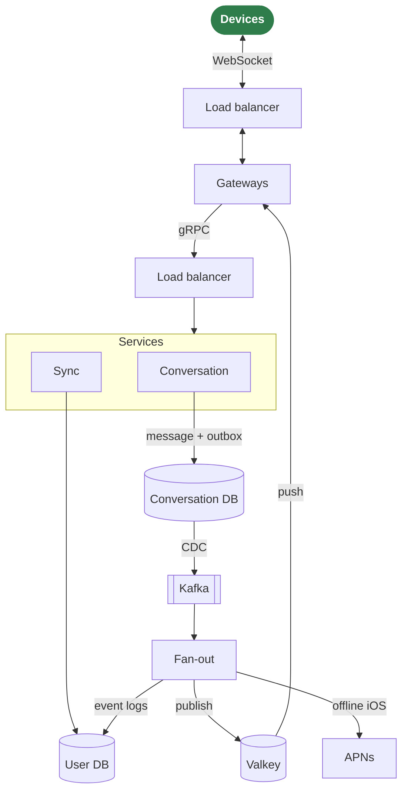

# Wrinkle

*A new wrinkle on messaging.*

Wrinkle is a prototype backend for one-to-one text messaging across multiple devices per user: real-time delivery to connected devices, incremental sync for the rest, and read receipts. The same architecture is implemented in several languages, with shared clients and a load generator, to see how each implementation behaves as load grows.

It is an experiment, not a product. Nothing here is production-hardened; [docs/production.md](docs/production.md) lists what that would take, with deployment options and their costs.

**Status:** Go and Java backends, each as one process or split into gateways and services, and Elixir and Rust gateways pass the same conformance tests. Split, they run side by side in any number and language behind load balancers, natively or as a cluster of containers. The web and iOS clients work against any of them, with APNs push to iOS devices that are not connected. Measurements and the four-way comparison are in [docs/results/](docs/results/). See [ROADMAP.md](ROADMAP.md) for what is done and what is open.

## How it works

Three ideas carry the design:

- **Per-conversation sequence.** Every message gets a sequence number from a counter owned by its conversation, assigned in the transaction that stores it. Every device orders a conversation by it, so all participants converge on the same order, and a device can tell when it is missing a message.
- **Per-user event log.** Everything a user's devices need to know (messages in any of their conversations, read receipts, delivery failures) is appended to that user's log. A device keeps one cursor into it, and sync returns what came after.
- **Push is an optimization, sync is the guarantee.** Connected devices get events over WebSocket as they happen. A device that misses a push gets the same events from its log on the next sync.



The diagram shows the split shape, which scales by adding gateways and services instances. A monolith runs the gateway, the services and the fan-out in one process, without the balancers.

Components:

- **Load balancers:** one spreads devices' connections over the gateways and moves them off one that stops; the other spreads the gateways' requests over the services instances, one request at a time, since each gateway keeps a single connection. HAProxy.
- **Gateway:** holds the WebSocket connections, tracks which device is connected where, and forwards requests to the services, in-process or over an internal gRPC contract (`proto/wrinkle/backend/v1`).
- **Conversation service:** sending and read marks; stores each change with an outbox row in one transaction.
- **Sync service:** sign-in and devices, incremental sync, conversation lists, push token registration.
- **Fan-out workers:** run in the services processes, one Kafka consumer group across them. They read committed changes from Kafka (captured from the outbox by Debezium), append them to each participant's event log, and publish them to the gateways holding the participants' devices. Devices that are not connected and have registered for push get an APNs notification instead.
- **Conversation DB and user DB:** messages and the outbox, sharded by conversation; event logs, conversation lists and devices, sharded by user.
- **Presence:** which device is connected to which gateway node, and one push channel per user, in Valkey.

Infrastructure: MySQL sharded with Vitess (one keyspace by conversation, one by user), Apache Kafka, Debezium, Valkey, and Prometheus with Grafana for the metrics every backend exposes under the same names.

## Implementations

All backends implement the same Protobuf contract and pass the same conformance tests, so clients and the load generator work against any of them. A backend can also be split into gateways and services instances over an internal RPC, any number of each behind balancers, which is the shape the design scales in. The Elixir and Rust implementations are gateways only, since connection handling is where the languages differ most; Go and Java services serve them all, in one pool.

| Backend | Shape | Push |
|---|---|---|
| Go | all roles in one process, or gateways and services instances | yes |
| Java | all roles in one process, or gateways and services instances | stores tokens, does not send yet |
| Elixir | gateways, beside Go or Java services | through the Go services |
| Rust | gateways, beside Go or Java services | through the Go services |

Clients: a web client (React and TypeScript, served as a static site) and an iOS client (SwiftUI), both working against any backend.

## Measuring

The load generator simulates devices and reports, per backend on the same machine and infrastructure:

- memory per idle connection, from the slope across several connection counts;
- end-to-end latency, send to receive, p50 and p99, at fixed message rates;
- the highest sustained message rate before p99 latency breaks;
- CPU time per thousand messages.

Absolute numbers depend on the machine and say little about production. Comparisons between backends under identical conditions are the point. In the latest runs ([2026-10-11](docs/results/2026-10-11-gateways.md)), every implementation sustained 500 messages per second with 75 to 110 ms median latency end to end; the Rust gateway was the leanest, holding 4000 idle connections in 78 MiB against 150 to 400 MiB for the others. Above 500 per second the shared database, not a backend, sets the limit on a laptop. The protocol is in [docs/measuring.md](docs/measuring.md), results in [docs/results/](docs/results/), metric names in [docs/metrics.md](docs/metrics.md), and the capacity the design was sized for, with the measurements against it, in [docs/capacity.md](docs/capacity.md).

## Running

Needs Docker Desktop with at least 8 GB of memory (12 GB for the cluster), Go, Node 22 or later, JDK 25 (found through `java_home`), Elixir, Rust, Xcode 26, and `make tools` once for the code generators and linters. The cluster alone needs only Docker. Plain `make` lists every routine operation, grouped; the common ones:

```sh
make infra-up          # the shared stack: Vitess, Kafka, Debezium, Valkey, Prometheus, Grafana
make run-go-mono       # a whole backend on ws://localhost:8080/v1/ws; also run-java-mono
make lb-up             # or side by side: balancers, then run-go-services or run-java-services, and gateways run-*-gw
make cluster-up        # or all of that in containers, any number of each: GO_GW=3 JAVA_SERVICES=0 ...
make web               # the web client, built and served on port 8081
make ios-sim           # the iOS app in a simulator; ios-device on a paired iPhone
make load              # a quick load run against the running backend
make ci                # the gate before every push: lint, tests, conformance against every backend
make measure-go-mono   # the measurement protocol for one backend; measure-all for every one
make infra-down        # stop and discard all data
```

Grafana is at http://localhost:3000 with a dashboard over the backend's metrics, Prometheus at http://localhost:9090. With `make web` running, http://localhost:8081/monitor (`make monitor`) links to every dashboard and endpoint and shows which answer; like them, it is served only on the host.

To run it on one Mac and connect from phones and other computers on the same network, see [docs/local-network.md](docs/local-network.md).

## Layout

```text
proto/        the contract: wrinkle/v1 for devices, wrinkle/backend/v1 between gateway and services
schema/       SQL schemas and Vitess keyspace definitions
infra/        Docker Compose for Vitess, Kafka, Debezium, Valkey, Prometheus and Grafana, HAProxy for the side-by-side setup, and the cluster; the arm64 Vitess image
backends/     go/, java/, elixir/ and rust/ (gateways), each with a Dockerfile for the cluster
clients/      web/ (React), ios/ (SwiftUI), go/ (the library the tests and load generator use)
loadgen/      load generator and the measurement protocol script (Go)
conformance/  backend-agnostic tests against the contract
docs/         measuring, metrics, capacity, running on a local network, toward production, and results
```

Local settings that are not committed, the Apple team and the APNs key, go in `.env` at the root; see `.env.example`.

## License

[MIT](LICENSE).
