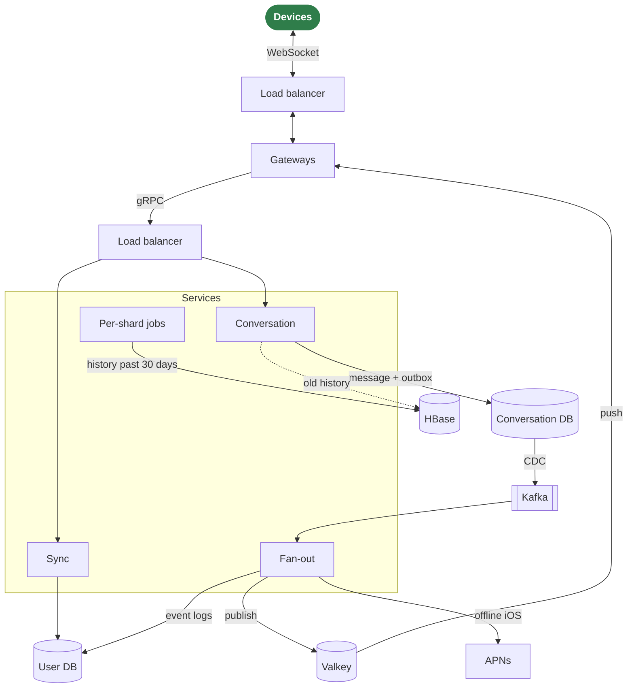

# Wrinkle

*A new wrinkle on messaging.*

Wrinkle is a prototype backend for text messaging, one-to-one and in groups, across multiple devices per user, each of whom also has notes shared among their own devices: real-time delivery to connected devices, incremental sync for the rest, and read receipts. The same architecture is implemented in several languages, with shared clients and a load generator, to see how each implementation behaves as load grows.

It is an experiment, not a product. Solid:

- the contract, and the conformance tests that hold every backend to it;
- per-connection limits, keepalive, close codes and drain in every gateway;
- accounts with argon2id passwords and a token per device, and TLS to devices;
- end-to-end encryption, with test vectors shared by Go, TypeScript and Swift;
- a fan-out that delivers at least once without duplicates;
- the measurement protocol.

Prototype:

- one Vitess process rather than a topology, which starts empty when its container restarts;
- no limits per user or per address, and no password recovery;
- no reporting or moderation;
- no forward secrecy between key rotations;
- no alerting on the metrics.

[docs/production.md](docs/production.md) lists what a public deployment would take, with deployment options and their costs.

**Status:** Go, Java and TypeScript backends, each as one process or split into gateways and services, and Elixir and Rust gateways pass the same conformance tests. Split, they run side by side in any number and language behind load balancers, natively or as a cluster of containers. The web and iOS clients work against any of them, with APNs push to iOS devices that are not connected. Measurements comparing the shapes are in [docs/results/](docs/results/). See [ROADMAP.md](ROADMAP.md) for what is done and what is open.

Users register with a name and a password, sign in on any number of devices, each with its own token, and manage their profile (name, icon, picture), their devices and their account, which they can delete. Users become contacts by asking and accepting, and can block anyone. Conversations are direct, between any two users, or groups of up to 256 of the creator's and members' contacts, with a topic and admins. Messages carry text, a sticker or attachments (images and files, with thumbnails); their sender can delete them for everyone, anyone can react to them with up to three emoji, and every participant's read position is shared. Content is encrypted end to end: the servers see who talks to whom and when, group topics and membership, profiles and avatars, and sizes, but no text, sticker, attachment or reaction.

## How it works

Four ideas carry the design:

- **Per-conversation sequence.** Every message gets the next number of its conversation's counter, in the transaction that stores it. Every device orders a conversation by it, so all participants converge on the same order, and a device can tell when it is missing a message.
- **Per-user event log.** Everything a user's devices need to know (messages, read receipts, deletions and reactions in any of their conversations, and changes to their profile, devices, contacts and sticker palette) is appended to that user's log. A device keeps one cursor into it, and sync returns what came after.
- **Push is an optimization, sync is the guarantee.** Connected devices get events over WebSocket as they happen. A device that misses a push gets the same events from its log on the next sync.
- **The log delivers, the conversations keep the history.** A log keeps 30 days of events; a device away longer starts over from its conversations. History is kept for good: the last 30 days in MySQL, older messages in HBase, where a conversation's history reads as one range.



A message's path: the gateway passes the send to the conversation service, which stores the message with an outbox row in one transaction. Debezium carries the committed outbox row through Kafka to the fan-out, which appends the event to every participant's log and publishes it to the gateways holding their devices; devices that are not connected get an APNs notification. The diagram shows the split shape, which scales by adding gateways and services instances; a monolith runs everything in one process, without the balancers. The full picture, with the data model, the flows, the guarantees and what happens when a part fails, is in [docs/architecture.md](docs/architecture.md).

Components:

- **Load balancers** (HAProxy): one sends each device's connection to the gateway with the fewest; the other spreads the gateways' requests over the services instances, one request at a time. TLS ends at an edge in front of the device balancer, locally on port 8443.
- **Gateways** hold the WebSocket connections, track in Valkey which device is connected where, and forward requests to the services, in-process or over an internal gRPC contract (`proto/wrinkle/backend/v1`). They enforce the contract's limits per connection and drain on shutdown.
- **Services**, stateless: the *conversation service* owns the conversation keyspace (sends, read marks, groups, deletions, reactions, key epochs, history in both tiers); the *sync service* owns the user keyspace (accounts, devices, profiles, contacts, sync, conversation lists, uploads, stickers, push tokens).
- **Background work**, in the services processes: the *fan-out*, one Kafka consumer group across them; per shard, the *log trimmer* and the *history mover*, each shard's round leased in Valkey to one instance at a time, so instances share the shards; and a sweeper of unused uploads.
- **Storage:** MySQL in two keyspaces, by conversation and by user, sharded with Vitess or on one plain MySQL; HBase for history older than 30 days; object storage for blobs (avatars, stickers, attachments); Valkey for presence, push channels and the leases; Kafka for the change stream.

Message content is encrypted end to end: the services store and relay ciphertext and the keys devices wrap for each other, which they cannot unwrap.

Infrastructure locally: Vitess (or MySQL), Kafka, Debezium, Valkey, Garage for blobs, HBase and its REST server, and Prometheus with Grafana for the metrics every backend exposes under the same names.

## Implementations

All backends implement the same Protobuf contract and pass the same conformance tests, so clients and the load generator work against any of them. A backend can also be split into gateways and services instances over an internal RPC, any number of each behind balancers, which is the shape the design scales in. The Elixir and Rust implementations are gateways only, since connection handling is where the languages differ most; Go, Java and TypeScript services serve them all, in one pool.

| Backend | Shape | Push |
|---|---|---|
| [Go](backends/go/README.md) | all roles in one process, or gateways and services instances | yes |
| [Java](backends/java/README.md) | all roles in one process, or gateways and services instances | yes |
| [TypeScript](backends/ts/README.md) | all roles in one process, or gateways and services instances | yes |
| [Elixir](backends/elixir/README.md) | gateways, beside Go, Java or TypeScript services | through the services |
| [Rust](backends/rust/README.md) | gateways, beside Go, Java or TypeScript services | through the services |

Clients: a [web client](clients/web/README.md) (React and TypeScript, served as a static site) and an [iOS client](clients/ios/README.md) (SwiftUI), both working against any backend, and the [Go client library](clients/go/README.md) the tests and the load generator use.

## Measuring

The load generator simulates devices and reports, per backend on the same machine and infrastructure:

- memory per idle connection, from the slope across several connection counts;
- end-to-end latency, send to receive, p50 and p99, at fixed message rates;
- the highest sustained message rate before p99 latency breaks;
- CPU time per thousand messages.

Absolute numbers depend on the machine and say little about production. Comparisons between backends under identical conditions are the point. In the latest runs ([2026-10-24](docs/results/2026-10-24-shapes.md)), five of the eight shapes sustained 1000 messages per second with end-to-end encryption, and the other three 500; at 500 per second the median latency end to end was 61 to 68 ms. The Rust gateway was the leanest, at about two thirds of the Go gateway's CPU per message and under half its memory under load. Above about 1000 per second the shared database, not a backend, sets the limit on a laptop. The protocol is in [docs/measuring.md](docs/measuring.md), results in [docs/results/](docs/results/), metric names in [docs/metrics.md](docs/metrics.md), and the capacity the design was sized for, with the measurements against it, in [docs/capacity.md](docs/capacity.md).

## Running

Needs Docker Desktop with at least 8 GB of memory (12 GB for the cluster), mkcert for TLS (`brew install mkcert && mkcert -install`, once), Node 22 or later for the web client (26 or later for the TypeScript backend), and, only for the native backends and clients, Go, JDK 25 (found through `java_home`), Elixir, Rust and Xcode 26, with `make tools` once for the code generators and linters. The main path, on one Mac:

1. `make infra-up`: the shared stack in Docker (Vitess, Kafka, Debezium, Valkey, Garage, HBase and its REST server, Prometheus, Grafana). `make infra-up PROFILE=mysql` runs plain MySQL in place of Vitess, the same schema unsharded.
2. `make cluster-up`: the whole backend in containers, two Go, one Java and one TypeScript services instances and a gateway in each language behind balancers, serving devices on `ws://localhost:8080/v1/ws`. The same from one native process is `make run-go-mono`, `make run-java-mono` or `make run-ts-mono`; `mono` in a target name is the monolith, `gw` a gateway.
3. `make web`: the web client, built and served over HTTPS on port 8081, together with the TLS edge on port 8443 in front of whatever serves port 8080 (`make tls-up`, which makes the certificate with mkcert if there is none yet). Devices reach the backend only through the edge: port 8080 listens on loopback, and the web server refuses to serve the network without a certificate.
4. Open `https://localhost:8081/` on the Mac. Phones and other computers on the network open the Mac's address instead and must trust the certificate first: [docs/local-network.md](docs/local-network.md), which also covers the iOS app, push notifications and running the backends natively.

Grafana is at http://localhost:3000 with a dashboard over the backend's metrics, Prometheus at http://localhost:9090, and https://localhost:8081/monitor (`make monitor`) links to every dashboard and endpoint and shows which answer. `make ci` is the gate before every push: lint, tests, conformance against every backend. `make measure-go-mono` runs the measurement protocol for one backend, `make measure-all` for every one. `make infra-down` stops the stack and discards all data; `make infra-reset` recreates it empty. A restart of the Vitess container empties its database too; `make infra-up` then restarts the change stream on the new one. Plain `make` lists every routine operation, grouped.

## Layout

```text
proto/        the contract: wrinkle/v1 for devices, wrinkle/backend/v1 between gateway and services
schema/       SQL schemas, Vitess keyspace definitions and the HBase table
infra/        Docker Compose for Vitess or MySQL, Kafka, Debezium, Valkey, Garage, HBase, Prometheus and Grafana, HAProxy for the TLS edge and the side-by-side setup, and the cluster; the arm64 Vitess image and the HBase image
backends/     go/, java/, ts/, elixir/ and rust/ (gateways), each with its architecture in a README and a Dockerfile for the cluster
clients/      web/ (React), ios/ (SwiftUI), go/ (the library the tests and load generator use)
loadgen/      load generator and the measurement protocol script (Go)
conformance/  backend-agnostic tests against the contract
docs/         architecture, measuring, metrics, capacity, running on a local network, toward production, history, and results
```

Local settings that are not committed, the Apple team and the APNs key, go in `.env` at the root; see `.env.example`.

## License

[MIT](LICENSE).
