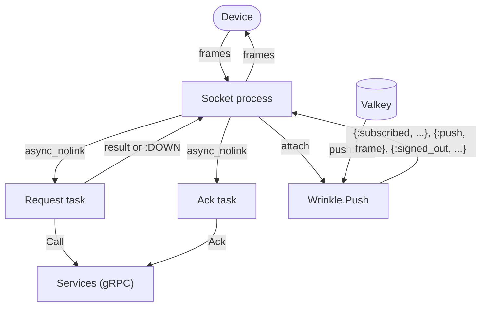

# Elixir gateway

The Elixir implementation is a gateway only: it holds the devices' WebSocket connections and forwards every request to a Go or Java services process over the internal RPC (`proto/wrinkle/backend/v1`), with pushes arriving through Valkey. It runs beside one services process for conformance and measurement ([run.sh](run.sh)), or as one of any number of gateways behind the balancers, natively or in the cluster. It runs on the BEAM with Bandit for HTTP and WebSocket, elixir-grpc over Mint for the RPC, and Redix for Valkey. A gateway came first in Elixir because connection handling is where the languages differ most; the services are SQL and a Kafka consumer, where they differ least, so they were left out (ROADMAP.md, phase 7). The architecture common to every backend, the data model, the flows and the failure handling, is in [docs/architecture.md](../../docs/architecture.md); this page covers how the Elixir code realizes the gateway's part.

## Layout

One module per concern, all under `lib/wrinkle/`:

```text
application.ex   the supervision tree, configuration, drain on stop
router.ex        HTTP: the WebSocket upgrade, /healthz, /metrics, /debug/*
socket.ex        one connection: frames, limits, request dispatch, pushes, close codes
token_bucket.ex  the per-connection rate limit, a pure function
ack_writer.ex    one ack write at a time, coalescing to the highest cursor, a pure function
backend.ex       the RPC client to the services: one HTTP/2 channel, connected in the background
push.ex          Valkey pub/sub, one channel per user, to the connection processes; who is attached
presence.ex      the presence hash and this instance's expiring key
keepalive.ex     one sweep every 30 s: ping, or close the idle
drain.ex         graceful shutdown
metrics.ex       ETS counters rendered in the Prometheus text format
proto/           generated by protoc-gen-elixir (make proto); not formatted, not edited
```

Configuration is in [config/runtime.exs](config/runtime.exs), dependencies in [mix.exs](mix.exs), unit tests in `test/`.

## Roles and startup

There is one role, the gateway, so there are no role flags. [config/runtime.exs](config/runtime.exs) reads the same environment variables the other backends take as flags:

| Variable | Default | Meaning |
|---|---|---|
| `WRINKLE_LISTEN` | `:8080` | HTTP and WebSocket address, host:port; an empty host means every interface (IPv4), a name is resolved at startup, an IPv6 address goes in brackets |
| `WRINKLE_SERVICES` | `localhost:9000` | services RPC address, a services process or the services balancer |
| `WRINKLE_VALKEY` | `localhost:6379` | Valkey, for presence and pushes |
| `WRINKLE_NODE` | the host name | first part of the instance id in presence entries |

[application.ex](lib/wrinkle/application.ex) creates the ETS metrics table, makes the instance id (`<node>/<16 random hex chars>`, kept in `:persistent_term`), and starts one `:one_for_one` supervisor:

```text
Wrinkle.Supervisor (one_for_one)
├── Registry Wrinkle.Sockets        every open connection, partitioned per scheduler
├── Redix Wrinkle.Valkey            commands: presence
├── Redix.PubSub Wrinkle.ValkeyPubSub
├── Wrinkle.Presence                refreshes gateway:<instance id>
├── PartitionSupervisor Wrinkle.PresenceWriters   one presence writer per scheduler
├── Wrinkle.Backend                 connects the RPC channel, retrying
├── Wrinkle.Push                    owns the push:<user id hex> subscriptions
├── Wrinkle.Keepalive               the 30 s sweep
├── Task.Supervisor Wrinkle.Tasks   one task per request, one per ack write
└── Bandit (Wrinkle.Router)
    └── Thousand Island acceptors
        └── one process per connection, running Wrinkle.Socket
```

The order matters: Valkey, presence and the push subscriber are up before Bandit accepts a connection, and the task supervisor stops after Bandit. The services need not be: `Wrinkle.Backend` connects in the background, retrying every 0.1 s and backing off to every 2 s, and until it has connected every request is answered `ERROR_CODE_UNAVAILABLE`. Once connected, a channel that drops is reconnected by the Mint adapter (elixir-grpc's `retry` option), meanwhile requests get `ERROR_CODE_UNAVAILABLE` too. Redix connects to Valkey in the background as well and reconnects with backoff (0.5 s growing to 30 s). In the container the application runs in the prod environment, where it is permanent: if the supervisor gives up, the VM exits and the container ends. The RPC channel is stored in `:persistent_term`, so request tasks use it directly, without a call through the `Backend` process; requests are concurrent HTTP/2 streams on that one channel. The services must allow many concurrent streams per connection: elixir-grpc fails a call beyond the limit rather than queuing it, which once lost a third of the requests under a connect storm (see Measured).

## Connections

Each connection is one BEAM process: Bandit's connection process, running the `WebSock` callbacks in [socket.ex](lib/wrinkle/socket.ex). Its state is the device (`nil` until Connect succeeds), where the Connect stands (none, forwarded, waiting for the push subscription, done), the running tasks by monitor, the token bucket, the in-flight count, the ack writer state, when a frame last arrived, and whether it is draining.



Reading: Bandit decodes WebSocket frames and calls `handle_in`. Each binary frame is decoded as a `Frame`; a decode failure or a frame kind a client may not send closes with 1008, a text frame with 1003. Every accepted frame takes a token from the bucket first.

Request dispatch: a request is run in a task under `Wrinkle.Tasks`, started with `Task.Supervisor.async_nolink`, which forwards it with the connection's device and returns the response to the socket process, so a slow request never blocks pushes or other requests. The socket monitors each task: one that crashes is answered `ERROR_CODE_INTERNAL` and its in-flight slot released, and an ack write that crashes counts as finished. Before Connect, only Register, SignIn and Connect are forwarded, with an empty user id; any other request is answered `ERROR_CODE_UNAUTHENTICATED` "connect first". Register, SignIn and Connect are forwarded only while no Connect is: one sent while a Connect is forwarded or after it succeeded gets `ERROR_CODE_FAILED_PRECONDITION` "already connected" at once, and a Connect that failed may be retried. A Connect response without a 16-byte user id is answered `ERROR_CODE_INTERNAL`. User ids are 16-byte binaries; Valkey names a user by their lowercase hex. When a Connect succeeds, the socket binds to that device: it attaches to `Wrinkle.Push` for the user's channel, writes its presence entry, and holds the response until `Wrinkle.Push` reports the channel subscribed, so no push after the response is missed; if that takes over 5 s (Valkey unreachable), it detaches, removes its presence entry and answers `ERROR_CODE_UNAVAILABLE`, and Connect may be retried within a fresh 5 s deadline. An RPC failure or timeout (10 s) answers `ERROR_CODE_UNAVAILABLE`; every request is answered. Durations are measured in the socket process, from reading the request to queueing its response.

Writing and the outbound queue: only the socket process writes, by returning `{:push, frame, state}` from a callback. Its mailbox is the outbound queue. When a push arrives and the mailbox holds more than 64 messages (32 pushes plus up to 32 pending responses), the connection is closed with 1013. Bandit's socket send timeout of 10 s bounds a write to a device that does not read.

The limits from the contract ([frame.proto](../../proto/wrinkle/v1/frame.proto)):

| Limit | Where |
|---|---|
| Frame at most 64 KiB, else 1009 | Bandit's `max_frame_size` (64 KiB plus the 14-byte header) and `max_fragmented_message_size`, set in [router.ex](lib/wrinkle/router.ex) |
| Connect within 5 s, else 1008 | a `{:connect_deadline, ref}` message sent to itself at `init`, and again with a new ref when a Register or SignIn is answered (hashing the password takes a while) or a Connect is undone; only the latest ref counts |
| 50 frames a second, bursts of 100 | [token_bucket.ex](lib/wrinkle/token_bucket.ex), in thousandths of a token; a request over it gets `ERROR_CODE_RESOURCE_EXHAUSTED`, an ack, ping or pong is dropped |
| 32 requests in flight | the in-flight count, a Connect until its response is sent; beyond it, `ERROR_CODE_RESOURCE_EXHAUSTED` |
| One ack write at a time | [ack_writer.ex](lib/wrinkle/ack_writer.ex): acks arriving during a write are coalesced to the highest cursor and written when it finishes |
| Ping every 30 s, close after 90 s idle with 1001 | [keepalive.ex](lib/wrinkle/keepalive.ex): one process broadcasts to every socket every 30 s instead of a timer per connection; a socket that has seen any frame, control frames included, since the idle bound sends a WebSocket ping, otherwise closes |
| Internal error, 1011 | Bandit, when a socket process fails |

Application-level pings are answered with a pong from the socket process. Bandit's read timeout of 150 s is only a backstop for a peer that never completes the closing handshake.

Push delivery: [push.ex](lib/wrinkle/push.ex) is one process that keeps which connection processes are attached for each user, monitoring them, and is the only subscriber on the `Redix.PubSub` connection. It subscribes to `push:<user id hex>` when a user's first connection attaches and unsubscribes when the last detaches or exits. Neither waits on Valkey: `Redix.PubSub` sends the command and applies subscribes and unsubscribes in call order, so an unsubscribe racing a new attach ends subscribed. Valkey's confirmation comes back as a message; on it the user's connections get `{:subscribed, user_id}`, which comes before any push to them, as both are sent by this process. A confirmation already queued when an unsubscribe returns belongs to the subscription it ended and is discarded. When the Valkey connection drops, `Redix.PubSub` reports it, reconnects with backoff and resubscribes every channel still subscribed; until each is confirmed again, new Connects wait. If the `Redix.PubSub` process itself exits, `Wrinkle.Push` stops with it and every connection closes with 1011, as each monitors it once attached. A message on the channel is a serialized `wrinkle.backend.v1.Push`. Its `event` is an already serialized `Event`, wrapped into a `Frame` without decoding it and sent to every connection attached for the user; a `Push` holding only an event differs from that `Frame` only in the field tag, so the common case swaps the tag byte, and anything else goes through the generated decoder. A `signed_out` is sent to the user's connections as `{:signed_out, device_ids | :all}`, and each one whose device is listed, or every one for `all_devices`, closes with 4001 "signed out". A message that does not decode is logged and dropped.

Presence and the instance key: [presence.ex](lib/wrinkle/presence.ex) writes `presence:<user id hex>`, a hash from device id to this instance id, on attach, and on close removes the entry with a Lua script only if it still names this instance, so a device that reconnected elsewhere keeps its new entry. A connection casts these writes to one of the `Wrinkle.Presence.Writer` processes, chosen by user id, so a user's writes stay in order and a connection never waits on Valkey. The same process sets `gateway:<instance id>` with a 90 s expiry every 30 s (retrying every second on failure); entries of a gateway that died stop counting once the key expires.

Drain on shutdown: SIGTERM stops the application, and `prep_stop` runs [drain.ex](lib/wrinkle/drain.ex) before the supervisor stops its children. It sets a flag that makes `/healthz` and new upgrades answer 503, and broadcasts `{:drain, 5000}` to every socket. A socket with nothing in flight closes with 1001 at once; one with requests in flight answers new requests with `ERROR_CODE_UNAVAILABLE` (counted in the metrics like the other refusals), closes with 1001 after its last response, or after 5 s at the latest. The drain waits until every socket has closed or the grace has passed, then deletes the instance key. The VM ignores SIGINT when started with `+Bi`, which [run.sh](run.sh) and [gateway.sh](../gateway.sh) set, so Ctrl-C reaches it as SIGTERM through the scripts and drains too.

## Metrics and debug endpoints

All on the gateway's port, from [router.ex](lib/wrinkle/router.ex):

- `GET /v1/ws`: the WebSocket endpoint, the only one the device balancer passes.
- `GET /healthz`: 200, or 503 while draining.
- `GET /metrics`: Prometheus text rendered from ETS counters by [metrics.ex](lib/wrinkle/metrics.ex): connections, events pushed (counted when the socket process takes a push from its mailbox and writes it; pushes that close a slow connection, or are still in the mailbox when it closes, are not), requests by type and code, request duration histograms, `process_cpu_seconds_total` from the VM's runtime, and `erlang_vm_memory_bytes_total` for processes and system. The VM has no resident memory figure; the load generator reads it with `ps`. Names are in [docs/metrics.md](../../docs/metrics.md).
- `GET /debug/queues`: the eight processes with the longest mailboxes, for finding a bottleneck.
- `POST /debug/gc`: garbage-collects every process, before reading live memory.

The `/debug` paths answer only from loopback addresses (IPv4, IPv6 and IPv4-mapped IPv6), 403 otherwise.

## Building, running, testing

The make targets for this backend:

| Target | What it does |
|---|---|
| `make build-elixir` | fetches the dependencies and compiles |
| `make run-elixir-gw` | a gateway on :8181 behind the balancers ([gateway.sh](../gateway.sh)); needs `make lb-up` and a services instance |
| `make cluster-up ELIXIR_GW=n` | n gateways in containers, built from [Dockerfile](Dockerfile) |
| `make conformance-elixir-gw` | the conformance tests against [run.sh](run.sh) |
| `make measure-elixir-gw` | the measurement protocol, results labeled `elixir` |
| `make elixir-lint` | `mix format --check-formatted` and a compile with warnings as errors |
| `make elixir-test` | the unit tests |
| `make proto` | regenerates `lib/wrinkle/proto` with the other languages |

[run.sh](run.sh) starts the gateway through [beside-services.sh](../beside-services.sh): a Go services process with the fan-out on 127.0.0.1:9000 (metrics on 8090), then the gateway on :8080 pointed at it; on exit the gateway stops first, so it drains while the services still answer. It runs `mix run --no-halt` in the default environment; the [Dockerfile](Dockerfile) builds and runs it with `MIX_ENV=prod`. There is no release build.

The unit tests run with `mix test --no-start`, without the application, Valkey or the services: [token_bucket_test.exs](test/token_bucket_test.exs) covers bursts, refill, the cap and partial refills; [ack_writer_test.exs](test/ack_writer_test.exs) one write in flight and coalescing; [push_test.exs](test/push_test.exs) the frame wrapping across varint boundaries, decoding pushes (events, sign-outs, garbage) and the hex of a user id. Everything else is covered by the conformance tests.

## Measured

On 2026-10-11 ([2026-10-11-gateways.md](../../docs/results/2026-10-11-gateways.md), raw runs in [2026-10-11-elixir.jsonl](../../docs/results/2026-10-11-elixir.jsonl)), beside the same Go services process as the Go and Rust gateways: 79 / 141 ms p50 / p99 at 100 messages a second and 110 / 437 ms at 500, 470 ms of gateway CPU per thousand messages, and 4000 idle connections in about 180 MiB, with a baseline above 100 MiB and the highest live memory slope of the gateways (37 KiB per connection, counting allocator carriers). The same run found grpc-go's default of 100 concurrent streams per connection failing the Elixir client's calls; the services now allow 2^20.

## Gaps

- No services: the conversation and sync services, the fan-out and push notifications run in a Go or Java process. APNs pushes reach devices only through Go services instances.
- Every attach and detach goes through the one `Wrinkle.Push` process, as does every push; it is a single serialization point per gateway, though it never waits on Valkey.
- A services channel that drops is reconnected by the Mint adapter with its own backoff, which grows to two minutes between attempts after a few minutes of outage, so recovery from a long services outage can lag.
- No resident memory metric and no release build; the gateway runs under `mix run`.
- As for every gateway: no limits per user or per address, which need shared state (ROADMAP.md, Hardening).
