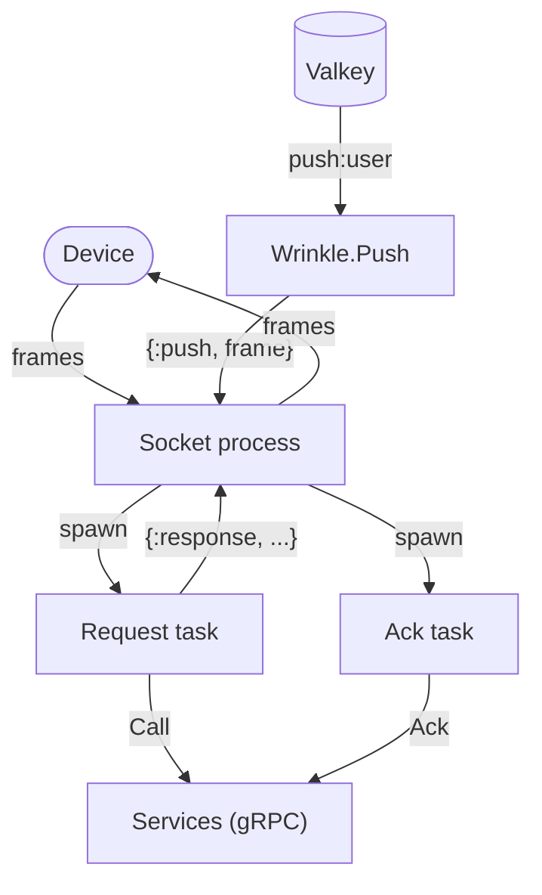

# Elixir gateway

The Elixir implementation is a gateway only: it holds the devices' WebSocket connections and forwards every request to a Go or Java services process over the internal RPC (`proto/wrinkle/backend/v1`), with pushes arriving through Valkey. It runs beside one services process for conformance and measurement ([run.sh](run.sh)), or as one of any number of gateways behind the balancers, natively or in the cluster. It runs on the BEAM with Bandit for HTTP and WebSocket, elixir-grpc over Mint for the RPC, and Redix for Valkey. A gateway came first in Elixir because connection handling is where the languages differ most; the services are SQL and a Kafka consumer, where they differ least, so they were left out (ROADMAP.md, phase 7). The architecture common to every backend, the data model, the flows and the failure handling, is in [docs/architecture.md](../../docs/architecture.md); this page covers how the Elixir code realizes the gateway's part.

## Layout

One module per concern, all under `lib/wrinkle/`:

```text
application.ex   the supervision tree, configuration, drain on stop
router.ex        HTTP: the WebSocket upgrade, /healthz, /metrics, /debug/*
socket.ex        one connection: frames, limits, request dispatch, pushes, close codes
token_bucket.ex  the per-connection rate limit, a pure function
ack_writer.ex    one ack write at a time, coalescing to the highest cursor, a pure function
backend.ex       the RPC client to the services: one HTTP/2 channel
push.ex          Valkey pub/sub, one channel per user, to the connection processes
presence.ex      the presence hash and this instance's expiring key
keepalive.ex     one sweep every 30 s: ping, or close the idle
drain.ex         graceful shutdown
metrics.ex       ETS counters rendered in the Prometheus text format
proto/           generated by protoc-gen-elixir (make proto); not formatted, not edited
```

Configuration is in [config/runtime.exs](config/runtime.exs), dependencies in [mix.exs](mix.exs), unit tests in `test/`.

## Roles and startup

There is one role, the gateway, so there are no role flags. [config/runtime.exs](config/runtime.exs) reads the same environment variables the other backends take as flags:

| Variable | Default | Meaning |
|---|---|---|
| `WRINKLE_LISTEN` | `:8080` | HTTP and WebSocket port; only the part after the last colon is used, and Bandit listens on every interface |
| `WRINKLE_SERVICES` | `localhost:9000` | services RPC address, a services process or the services balancer |
| `WRINKLE_VALKEY` | `localhost:6379` | Valkey, for presence and pushes |
| `WRINKLE_NODE` | the host name | first part of the instance id in presence entries |

[application.ex](lib/wrinkle/application.ex) creates the ETS metrics table, makes the instance id (`<node>/<16 random hex chars>`, kept in `:persistent_term`), and starts one `:one_for_one` supervisor:

```text
Wrinkle.Supervisor (one_for_one)
├── Registry Wrinkle.Connections    user id -> connection processes, for pushes
├── Registry Wrinkle.Sockets        every open connection, partitioned per scheduler
├── Redix Wrinkle.Valkey            commands: presence
├── Redix.PubSub Wrinkle.ValkeyPubSub
├── Wrinkle.Presence                refreshes gateway:<instance id>
├── Wrinkle.Backend                 connects the RPC channel
├── Wrinkle.Push                    owns the push:<user id> subscriptions
├── Wrinkle.Keepalive               the 30 s sweep
└── Bandit (Wrinkle.Router)
    └── Thousand Island acceptors
        └── one process per connection, running Wrinkle.Socket
            └── unsupervised tasks: one per request, one per ack write
```

The order matters: Valkey, presence, the RPC channel and the push subscriber are up before Bandit accepts a connection. `Wrinkle.Backend` fails to start if it cannot connect to the services, which stops the application. The RPC channel is stored in `:persistent_term`, so request tasks use it directly, without a call through the `Backend` process; requests are concurrent HTTP/2 streams on that one channel. The services must allow many concurrent streams per connection: elixir-grpc fails a call beyond the limit rather than queuing it, which once lost a third of the requests under a connect storm (see Measured).

## Connections

Each connection is one BEAM process: Bandit's connection process, running the `WebSock` callbacks in [socket.ex](lib/wrinkle/socket.ex). Its state is the device (`nil` until Connect succeeds), the token bucket, the in-flight count, the ack writer state, when a frame last arrived, and whether it is draining.



Reading: Bandit decodes WebSocket frames and calls `handle_in`. Each binary frame is decoded as a `Frame`; a decode failure or a frame kind a client may not send closes with 1008, a text frame with 1003. Every accepted frame takes a token from the bucket first.

Request dispatch: a request is run in a task started with `Task.start`, which forwards it with the connection's device and sends `{:response, {response, connected}}` back to the socket process, so a slow request never blocks pushes or other requests. Before Connect, any other request is answered `ERROR_CODE_UNAUTHENTICATED`; a Connect on a connected socket gets `ERROR_CODE_FAILED_PRECONDITION`. When a Connect response arrives, the socket binds to that device: it registers in `Wrinkle.Connections` under the user id, asks `Wrinkle.Push` to subscribe to the user's channel, and writes its presence entry. An RPC failure or timeout (10 s) answers `ERROR_CODE_UNAVAILABLE`; every request is answered.

Writing and the outbound queue: only the socket process writes, by returning `{:push, frame, state}` from a callback. Its mailbox is the outbound queue. When a push arrives and the mailbox holds more than 64 messages (32 pushes plus up to 32 pending responses), the connection is closed with 1013. Bandit's socket send timeout of 10 s bounds a write to a device that does not read.

The limits from the contract ([frame.proto](../../proto/wrinkle/v1/frame.proto)):

| Limit | Where |
|---|---|
| Frame at most 64 KiB, else 1009 | Bandit's `max_frame_size` (64 KiB plus the 14-byte header) and `max_fragmented_message_size`, set in [router.ex](lib/wrinkle/router.ex) |
| Connect within 5 s, else 1008 | a `:connect_deadline` message sent to itself at `init` |
| 50 frames a second, bursts of 100 | [token_bucket.ex](lib/wrinkle/token_bucket.ex), in thousandths of a token; a request over it gets `ERROR_CODE_RESOURCE_EXHAUSTED`, an ack, ping or pong is dropped |
| 32 requests in flight | the in-flight count; beyond it, `ERROR_CODE_RESOURCE_EXHAUSTED` |
| One ack write at a time | [ack_writer.ex](lib/wrinkle/ack_writer.ex): acks arriving during a write are coalesced to the highest cursor and written when it finishes |
| Ping every 30 s, close after 90 s idle with 1001 | [keepalive.ex](lib/wrinkle/keepalive.ex): one process broadcasts to every socket every 30 s instead of a timer per connection; a socket that has seen any frame, control frames included, since the idle bound sends a WebSocket ping, otherwise closes |
| Internal error, 1011 | Bandit, when a socket process fails |

Application-level pings are answered with a pong from the socket process. Bandit's read timeout of 150 s is only a backstop for a peer that never completes the closing handshake.

Push delivery: [push.ex](lib/wrinkle/push.ex) is one process that subscribes to `push:<user id>` while this gateway holds a connection of that user, and unsubscribes when the last one closes. A message on the channel is an already serialized `Event`; it is wrapped into a `Frame` by prefixing the field tag and length, without decoding, and sent to every process registered under the user in `Wrinkle.Connections`.

Presence and the instance key: [presence.ex](lib/wrinkle/presence.ex) writes `presence:<user id>`, a hash from device id to this instance id, on attach, and on close removes the entry with a Lua script only if it still names this instance, so a device that reconnected elsewhere keeps its new entry. The same process sets `gateway:<instance id>` with a 90 s expiry every 30 s (retrying every second on failure); entries of a gateway that died stop counting once the key expires.

Drain on shutdown: SIGTERM stops the application, and `prep_stop` runs [drain.ex](lib/wrinkle/drain.ex) before the supervisor stops its children. It sets a flag that makes `/healthz` and new upgrades answer 503, and broadcasts `{:drain, 5000}` to every socket. A socket with nothing in flight closes with 1001 at once; one with requests in flight answers new requests with `ERROR_CODE_UNAVAILABLE`, closes with 1001 after its last response, or after 5 s at the latest. The drain waits until every socket has closed or the grace has passed, then deletes the instance key. The VM ignores SIGINT when started with `+Bi`, which [run.sh](run.sh) and [gateway.sh](../gateway.sh) set, so Ctrl-C reaches it as SIGTERM through the scripts and drains too.

## Metrics and debug endpoints

All on the gateway's port, from [router.ex](lib/wrinkle/router.ex):

- `GET /v1/ws`: the WebSocket endpoint, the only one the device balancer passes.
- `GET /healthz`: 200, or 503 while draining.
- `GET /metrics`: Prometheus text rendered from ETS counters by [metrics.ex](lib/wrinkle/metrics.ex): connections, events pushed, requests by type and code, request duration histograms, `process_cpu_seconds_total` from the VM's runtime, and `erlang_vm_memory_bytes_total` for processes and system. The VM has no resident memory figure; the load generator reads it with `ps`. Names are in [docs/metrics.md](../../docs/metrics.md).
- `GET /debug/queues`: the eight processes with the longest mailboxes, for finding a bottleneck.
- `POST /debug/gc`: garbage-collects every process, before reading live memory.

The `/debug` paths answer only from loopback addresses (IPv4, IPv6 and IPv4-mapped IPv6), 403 otherwise.

## Building, running, testing

The make targets for this backend:

| Target | What it does |
|---|---|
| `make build-elixir` | fetches the dependencies and compiles |
| `make run-elixir-gw` | a gateway on :8181 behind the balancers ([gateway.sh](../gateway.sh)); needs `make lb-up` and a services instance |
| `make cluster-up ELIXIR_GW=n` | n gateways in containers, built from [Dockerfile](Dockerfile) |
| `make conformance-elixir-gw` | the conformance tests against [run.sh](run.sh) |
| `make measure-elixir-gw` | the measurement protocol, results labeled `elixir` |
| `make elixir-lint` | `mix format --check-formatted` and a compile with warnings as errors |
| `make elixir-test` | the unit tests |
| `make proto` | regenerates `lib/wrinkle/proto` with the other languages |

[run.sh](run.sh) starts the gateway through [beside-services.sh](../beside-services.sh): a Go services process with the fan-out on 127.0.0.1:9000 (metrics on 8090), then the gateway on :8080 pointed at it; on exit the gateway stops first, so it drains while the services still answer. It runs `mix run --no-halt` in the default environment, as does the Dockerfile; there is no release build.

The unit tests run with `mix test --no-start`, without the application, Valkey or the services: [token_bucket_test.exs](test/token_bucket_test.exs) covers bursts, refill, the cap and partial refills; [ack_writer_test.exs](test/ack_writer_test.exs) one write in flight and coalescing; [push_test.exs](test/push_test.exs) the frame wrapping across varint boundaries. Everything else is covered by the conformance tests.

## Measured

On 2026-10-11 ([2026-10-11-gateways.md](../../docs/results/2026-10-11-gateways.md), raw runs in [2026-10-11-elixir.jsonl](../../docs/results/2026-10-11-elixir.jsonl)), beside the same Go services process as the Go and Rust gateways: 79 / 141 ms p50 / p99 at 100 messages a second and 110 / 437 ms at 500, 470 ms of gateway CPU per thousand messages, and 4000 idle connections in about 180 MiB, with a baseline above 100 MiB and the highest live memory slope of the gateways (37 KiB per connection, counting allocator carriers). The same run found grpc-go's default of 100 concurrent streams per connection failing the Elixir client's calls; the services now allow 2^20.

## Gaps

- No services: the conversation and sync services, the fan-out and push notifications run in a Go or Java process. APNs pushes reach devices only through Go services instances.
- Request tasks and ack tasks are started with `Task.start`, unlinked and unsupervised; a task that crashes leaves its request unanswered and the in-flight count one too high, though the RPC calls themselves catch every failure.
- Two Connect requests sent together on one connection are both forwarded, since the device is unknown until the first response; the connection binds to the first that answers and the second gets a success response rather than `ERROR_CODE_FAILED_PRECONDITION`.
- Every attach goes through the one `Wrinkle.Push` process, as does every push; it is a single serialization point per gateway.
- Requests refused during drain are not counted in `wrinkle_requests_total`; those refused by the limits are, with a duration of zero.
- No resident memory metric and no release build; the gateway runs under `mix run`.
- As for every gateway: no limits per user or per address, which need shared state (ROADMAP.md, Hardening).
