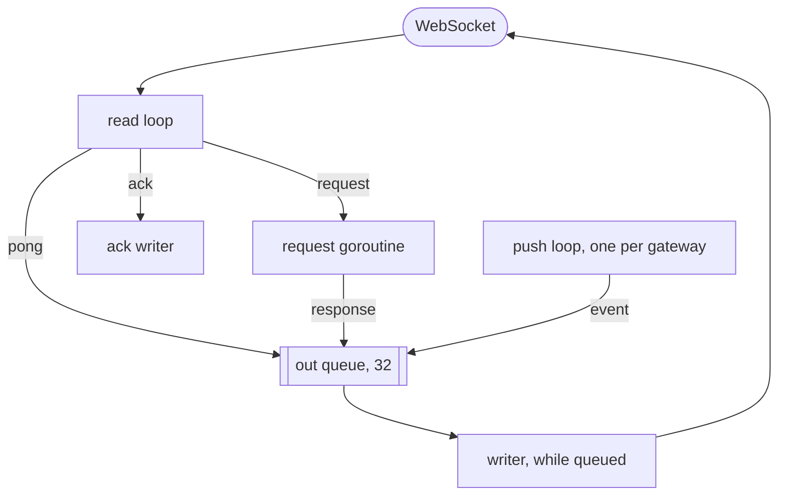

# Go backend

The Go backend is one binary, `bin/wrinkle`, that runs any of the three roles: the WebSocket gateway, the conversation and sync services, and the fan-out worker, with APNs push from the fan-out. It runs as a monolith (all roles in one process, the default) or split into gateways and services instances over the internal gRPC contract, and its services instances also serve the Elixir and Rust gateways. Go 1.27 with [coder/websocket](https://github.com/coder/websocket) for the connections, go-sql-driver/mysql against vtgate, [franz-go](https://github.com/twmb/franz-go) for Kafka, go-redis for Valkey, grpc-go for the internal RPC, and client_golang for metrics. coder/websocket was kept over gws and gobwas/ws as the mainstream, maintained choice ([idle memory](../../docs/results/2026-10-10-idle-memory.md)).

The design common to every backend (data model, flows, guarantees, failure handling) is in [docs/architecture.md](../../docs/architecture.md); this page covers how the Go code realizes it.

## Layout

```text
cmd/wrinkle/      main: flags, roles, startup and shutdown; HTTP mux; .env loading; APNs wiring
gateway/          WebSocket connections, limits, keepalive, per-user registry, push delivery, drain
services/         the Backend interface: Local (in-process) and the gRPC server and client
conversation/     conversation service: send, read marks, history, outbox rows
devicesync/       sync service: Connect, devices and acks, the event log, conversation lists, push tokens
fanout/           Kafka consumer: outbox rows to users' logs and conversation lists, then publish
push/             APNs client (token auth, HTTP/2) and the notifier for devices not connected
presence/         Valkey: device-to-instance hash, instance liveness keys, per-user push channels
internal/ids      ids derived from names and user pairs (xxhash, 63 bits)
internal/vtdb     a database/sql pool for one Vitess keyspace
internal/apierror contract error codes carried on Go errors
internal/metrics  the shared Prometheus metrics
split.sh          a Go gateway beside a Go services process, for conformance and measurement
Dockerfile        the image for the cluster, built from the repository root
```

## Roles and startup

[main.go](cmd/wrinkle/main.go) parses `--roles`, a comma-separated list of `gateway`, `services` and `fanout`:

- `gateway,fanout` (the default) is the monolith: the gateway calls the services in-process through `services.Local`.
- `gateway` with `--services <addr>` forwards every request over gRPC instead and opens no database pools. The channel connects lazily and reconnects with a backoff capped at 5 s, so the gateway starts and serves while the services are not reachable yet; until they are, requests fail fast with `UNAVAILABLE`.
- `services,fanout` is a services instance, as [services.sh](../services.sh), [beside-services.sh](../beside-services.sh) and the cluster run it.

Startup opens a pool per keyspace (`conversation`, `user`) when any role needs the database, connects to Valkey when a role needs it (gateway, fan-out; not a services-only process), then starts each role in its own goroutine; the HTTP server runs for every role. Before parsing flags, [env.go](cmd/wrinkle/env.go) reads `.env` from the working directory or beside `bin/`; variables already set win.

| Flag | Environment | Default | Meaning |
|---|---|---|---|
| `--roles` | `WRINKLE_ROLES` | `gateway,fanout` | roles to run |
| `--listen` | `WRINKLE_LISTEN` | `:8080` | HTTP: `/v1/ws` (gateway), `/metrics`, `/healthz`, debug |
| `--mysql` | `WRINKLE_MYSQL` | `127.0.0.1:15003` | vtgate |
| `--kafka` | `WRINKLE_KAFKA` | `localhost:19092` | brokers, comma-separated |
| `--valkey` | `WRINKLE_VALKEY` | `localhost:6379` | Valkey |
| `--services` | `WRINKLE_SERVICES` | empty | gateway: forward to this services address |
| `--services-listen` | `WRINKLE_SERVICES_LISTEN` | `:9000` | services: gRPC address |
| `--node` | `WRINKLE_NODE` | host name | prefix of the instance name in presence |
| `--db-conns` | `WRINKLE_DB_CONNS` | 64 | connections per keyspace pool |
| `--fanout-concurrency` | `WRINKLE_FANOUT_CONCURRENCY` | 64 | conversations delivered at a time |
| `--apns-key` | `WRINKLE_APNS_KEY` | empty | `.p8` key; push is off without it |
| `--apns-key-id` | `WRINKLE_APNS_KEY_ID` | from `AuthKey_<id>.p8` | key id |
| `--apns-team-id` | `WRINKLE_TEAM_ID` | empty | developer team |
| `--apns-topic` | `WRINKLE_APNS_TOPIC` | the app's bundle id | APNs topic |
| `--debug` | | false | debug logging |

On SIGINT or SIGTERM, or when a role fails, `/healthz` turns 503, the gateway drains (below), then the HTTP server and the other roles stop, all within 9.5 s. The gRPC server stops gracefully; the Kafka client leaves the group.

## Connections

Each connection is a `conn` in [conn.go](gateway/conn.go). The HTTP server's goroutine for the upgrade becomes the read loop; there is no writer goroutine while nothing is queued.



- **Reading.** The read loop reads one frame at a time (read limit 64 KiB, so the library closes oversize frames with 1009), records the time for the idle check, and decodes a `Frame`. A text frame closes with 1003, a malformed or unexpected one with 1008.
- **Requests.** Each request runs in its own goroutine under a 10 s timeout, from the server's request context rather than the connection's, so a drain can let it finish. `dispatch` enforces Connect first (`UNAUTHENTICATED`) and only once (`FAILED_PRECONDITION`), then calls `services.Backend`. A successful Connect records the user and device and attaches the connection to presence; the response goes out once the user's push channel is confirmed subscribed, or `UNAVAILABLE` if it is not within 5 s, after which the connection is unidentified again and Connect may be retried within a fresh 5 s deadline. A transport failure to the services becomes `UNAVAILABLE`.
- **Writing.** `send` puts serialized frames on a 32-slot channel and starts a writer goroutine if none runs; the writer exits when the queue is empty. Pushed events never wait: a full queue closes the connection with 1013 and the device syncs on reconnect. `wrinkle_events_pushed_total` counts only events accepted into the queue. Replies to the device's own frames wait up to 10 s for room, which holds back its read loop. A failed write closes with 1011.
- **Events** arrive from Valkey already serialized; `pushEvent` wraps the bytes in a `Frame` by writing the field tag, without decoding.

Limits from the contract ([limits.go](gateway/limits.go)):

| Limit | How |
|---|---|
| 50 frames/s, bursts of 100 | a token bucket per connection, used only by the read loop, so unlocked; every frame takes a token |
| 32 requests in flight | an atomic counter; requests over either limit get `RESOURCE_EXHAUSTED`, other frames are dropped |
| one ack write at a time | `ackCursor` keeps the highest pending cursor; one goroutine writes until none is pending |
| Connect within 5 s | a timer per connection, stopped by Connect; on expiry, close with 1008 |
| pings every 30 s, idle after 90 s | one ticker per gateway ([keepalive.go](gateway/keepalive.go)) sweeps all connections: idle ones close with 1001, the rest get a ping; pongs update the last-seen time |

**Push delivery and presence.** [presence.go](presence/presence.go) names each process `<node>/<random hex>` and keeps the key `gateway:<instance>` alive with a 90 s expiry, refreshed by the same 30 s ticker. A connected device is a field in the hash `presence:<user>` naming that instance; disconnecting removes the field only if it still names this instance (a Lua script), so a device that reconnected elsewhere keeps its entry. The gateway has one Valkey pub/sub connection, and the [registry](gateway/registry.go) keeps `push:<user>` subscribed on it while the user has a connection on this gateway. Attaching and detaching only change the user's connection set under a short lock and queue the user; one worker compares each queued user's desired state with what it last requested and sends SUBSCRIBE or UNSUBSCRIBE, up to 1000 channels per command, so no lock is held across a Valkey round trip and a detach racing an attach settles on the right state. Valkey confirms every channel of each command in order; an attach waits until its user's requests are all confirmed and the last was a subscribe. One receiving loop hands each push to every local connection of the user and counts the confirmations. If the pub/sub connection fails (an error, or no answer to a ping after 15 s of silence), the gateway replaces it rather than relying on go-redis's own reconnect, after a pause doubling from 100 ms to 5 s (reset once a connection has received anything), and subscribes every user with a connection again; pushes published in between reach those devices on their next sync.

**Drain** ([server.go](gateway/server.go)): new upgrades get 503 and the health check fails; every open connection is closed with 1001; requests in flight get 5 s, then their context is canceled; closing handshakes get 3 s more, after which remaining sockets are dropped; then the instance key is deleted, so pushes to its devices go to APNs at once rather than after 90 s.

## Services

`services.Backend` ([backend.go](services/backend.go)) has two methods, `Call` for a device's request with its identity and `Ack`. `Local` dispatches to the two services; `Client` forwards both over [`proto/wrinkle/backend/v1`](../../proto/wrinkle/backend/v1) ([rpc.go](services/rpc.go)). The client is one `grpc.ClientConn`, so in the side-by-side setup it is one HTTP/2 connection to the services balancer. The server allows 2^20 concurrent streams per connection, since grpc-go's default of 100 failed the Elixir gateway under a connect storm. A request's own failure travels as the response's error body; a gRPC error means the request was not handled.

**Conversation service** ([service.go](conversation/service.go)), against the `conversation` keyspace. `Send` validates, then in one transaction locks the conversation row (`SELECT ... FOR UPDATE`), returns the stored message if the client message id was seen before, otherwise takes `last_seq + 1`, inserts the message, and writes the outbox row. `MarkRead` does the same for read marks, moving only forward. The outbox row is inserted and deleted in the same transaction: the binlog keeps the insert for Debezium and the table stays empty. Opening a conversation creates its row with `INSERT IGNORE`; ids come from [ids.go](internal/ids/ids.go).

**Sync service** ([devicesync](devicesync/)), against the `user` keyspace: `Connect` creates the user and device on first use and returns the device's acked cursor and the log head; `Ack` moves the device's cursor forward with `GREATEST`; `Sync` reads the user's log after a cursor, up to 1000 events, with `has_more`; `Open` checks that the peer exists, creates the conversation if needed and adds it to the user's conversation list; `ListConversations` reads that list, most recent first; `RegisterPushToken` stores or clears an APNs token.

Pools: [vtdb.go](internal/vtdb/vtdb.go) interpolates parameters on the client, so vtgate sees no prepared statements, with 5 s connect and 10 s read and write timeouts.

**Fan-out worker** ([worker.go](fanout/worker.go)). One franz-go consumer in the group `wrinkle-fanout` on `wrinkle.conversation.outbox` (16 partitions, keyed by conversation id), shared with any Java services instances. Auto-commit is off and rebalances are blocked while a poll's records are handled. Per poll:

1. Records of each partition are grouped by key; each conversation's records run in offset order in one goroutine, up to `--fanout-concurrency` conversations at a time.
2. A record is parsed from Debezium's JSON ([outbox.go](fanout/outbox.go)) and delivered to both participants in parallel ([deliver.go](fanout/deliver.go)): in one transaction, lock the user row, append the event at `log_head + 1`, move the head, and update the conversation list (last message or read positions; for the sender, a message also moves its own read position to it, `GREATEST(read_seq, seq)` in the same statement). The unique key on the source outbox row turns a redelivery into a no-op. Then the event is published to `push:<user>`; a failed publish is only logged, since the log has it.
3. A failing record is retried five times with growing pauses. If it still fails, the worker rewinds every partition to the start of the poll, waits a second and fetches again, so nothing is skipped; malformed rows are logged and skipped.
4. When everything succeeded, the offsets are committed.

Peer names for notifications are cached in the worker, since names never change.

**Push notifications** ([push/](push/)). After a message is appended to a recipient's log, the worker calls `Notifier.MessageDelivered`, which returns at once: the send runs in a goroutine, at most 64 at a time, and beyond that it is dropped (`dropped` in the metrics). It reads the user's registered tokens, asks presence which devices are connected to a live instance (removing entries of instances whose key expired), computes the badge as unread messages across conversations, and sends an alert to each registered device that is not connected, never to the sender's own. [apns.go](push/apns.go) signs an ES256 provider token with the `.p8` key, reuses it for 45 minutes, and posts to the production or sandbox endpoint as the token was registered. A token APNs rejects (410, `BadDeviceToken`, `DeviceTokenNotForTopic`) is cleared, unless the device registered a new one meanwhile.

## Metrics and debug endpoints

Every role serves on `--listen` ([http.go](cmd/wrinkle/http.go)):

- `GET /metrics`: the shared metrics ([metrics.go](internal/metrics/metrics.go)) and the Go runtime's, uncompressed; names in [docs/metrics.md](../../docs/metrics.md).
- `GET /healthz`: 200, or 503 while shutting down.
- From loopback addresses only: `GET /debug/pprof/` (index, `profile`, `heap`, `goroutine`, `allocs`) and `POST /debug/gc`, which collects and returns memory to the OS before a measurement samples it.

The gateway adds `GET /v1/ws`. A services instance in the side-by-side setup listens on `127.0.0.1:8190+n`.

## Building, running, testing

| Target | What |
|---|---|
| `make build-go` | `bin/wrinkle` |
| `make run-go-mono` | all roles on `:8080`; `ARGS=...` passes flags |
| `make run-go-services` | a services and fan-out instance, `INSTANCE=n`, RPC on `:9100+n` |
| `make run-go-gw` | a gateway on `:8180` behind the balancers (`make lb-up`) |
| `make conformance-go-mono`, `conformance-go-gw` | the conformance tests against one shape |
| `make measure-go-mono`, `measure-go-gw` | the measurement protocol, from a fresh stack |
| `make cluster-up GO_SERVICES=2 GO_GW=1` | the image from the [Dockerfile](Dockerfile) in the cluster |

[split.sh](split.sh) runs a Go gateway beside a Go services process through [beside-services.sh](../beside-services.sh) (services on `127.0.0.1:9000`, metrics on `:8090`; the gateway is stopped first so it drains while the services answer). The same services process runs beside the Elixir and Rust gateways in their conformance and measurement, and the web and iOS client tests run against the Go monolith.

`make ci` runs golangci-lint on the module and the unit tests: the token bucket and ack coalescing, the push registry's reconciliation, request type labels, APNs signing, addressing, unregistered tokens and token reuse against a local server, key ids from file names, the 63-bit and symmetric ids, `.env` parsing and numeric variables, and the loopback check. Everything that needs the infrastructure is covered by the conformance tests instead.

## Measured

On 2026-10-11, from a fresh stack ([gateways](../../docs/results/2026-10-11-gateways.md)): the Go monolith held 4000 idle connections in 146 MiB and delivered 500 messages/s at 87 ms p50 and 277 ms p99 end to end; the split Go gateway held them in 167 MiB, at 94 / 574 ms and 454 ms of gateway CPU per thousand messages. Earlier runs: [Go](../../docs/results/2026-10-10-go.md), [Go against Java](../../docs/results/2026-10-10-go-vs-java.md), [idle memory per connection](../../docs/results/2026-10-10-idle-memory.md).

## Gaps

- A goroutine per connection, plus the one coder/websocket keeps for timeouts, sets the idle memory; the roadmap's second Go gateway on a poller-driven library would measure the alternative.
- `MessageFailedEvent` is never produced; the synchronous path has nothing to report with it.
- Acks are forwarded as they come, one write at a time per connection, not coalesced to once a minute as the design allows.
- Limits are per connection only; none per user or per address.
