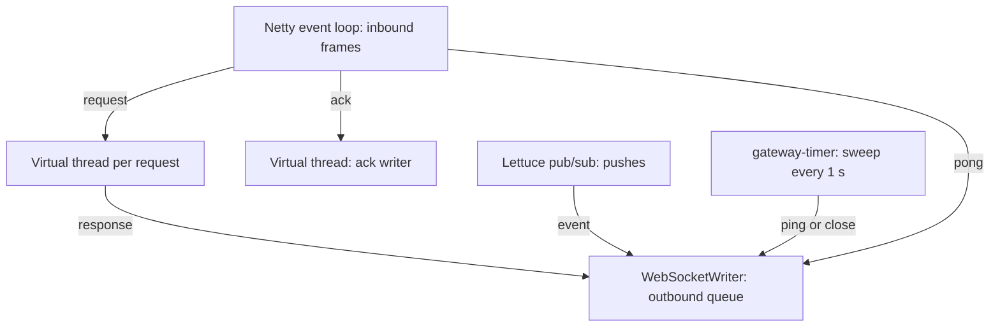

# Java backend

The Java backend is one binary with three roles, chosen by configuration: the gateway (WebSocket connections), the services (the account, conversation and sync services behind the internal RPC) and the fan-out worker (the Kafka consumer that fills the event logs and publishes pushes). It runs as a monolith with every role in one process, or split into gateways and services instances. Gateways in other languages can use its services instances, and its gateway can use theirs. It runs on JDK 25 with virtual threads, which no longer pin a carrier on `synchronized`. That is why plain blocking code (JDBC, blocking gRPC stubs, `Future.get`) is used throughout instead of a reactive style. Armeria over Netty serves the WebSocket endpoint, the internal gRPC and the operational endpoints. HikariCP over Connector/J talks to Vitess, the Kafka client consumes the outboxes, Lettuce talks to Valkey, and Bouncy Castle hashes passwords with argon2id.

The data model, flows and guarantees common to every backend are in [docs/architecture.md](../../docs/architecture.md). This page covers how the Java code implements them.

## Layout

```text
src/main/java/wrinkle/
  Main.java          roles, the HTTP server, operational endpoints, shutdown
  Config.java        flags and environment
  Db.java            a HikariCP pool per keyspace
  Uuid.java          user and conversation ids: random UUIDs, 16 bytes, hex in Valkey keys
  Ids.java           random 63-bit ids for devices and outbox rows
  ApiError.java      contract error codes and their wire form
  Metrics.java       the shared metric names
  Sql.java, Timestamps.java   small JDBC and time helpers
  MessageBody.java   message content as message.body and last_body store it
  gateway/           WebSocket endpoint, one Conn per device, limits, push routing
  presence/          Valkey: device presence, the instance key, push channels
  services/          the Backend interface, in-process and over the RPC, the RPC server
  accounts/          registration, sign-in, device tokens, passwords, profiles, name claims,
                     devices and their events, account deletion
  uploads/           upload slots, SigV4 presigning, the blob store client, the upload sweeper
  conversation/      direct conversations, groups and their notices, sending, read marks,
                     history, the outbox
  devicesync/        acks, sync, conversation list, push tokens
  fanout/            Kafka consumer, outbox record parsing, the per-user log writer, profile changes
src/test/java/wrinkle/   unit tests
```

The contract is generated at build time from the repository's [proto/](../../proto) by the Gradle protobuf plugin, with the gRPC stubs for `wrinkle.backend.v1`. Nothing generated is committed here.

## Roles and startup

[Main.java](src/main/java/wrinkle/Main.java) parses the configuration, opens what the roles need and starts one Armeria server:

- **Database pools** (`conversation` and `user` keyspaces) are opened when the process runs the services in any form: the `services` role, the `fanout` role, or a gateway without `--services`. Their `LocalBackend` wraps the three services.
- **gateway**: registers `/v1/ws` on the listen port. With `--services` it forwards over the RPC ([RpcClient](src/main/java/wrinkle/services/RpcClient.java)); without it, it calls `LocalBackend` in-process. It also starts the presence heartbeat and the connection sweep.
- **services**: adds a second port with the gRPC [RpcServer](src/main/java/wrinkle/services/RpcServer.java) on its own virtual host.
- **fanout**: starts the [FanoutWorker](src/main/java/wrinkle/fanout/FanoutWorker.java) on a platform thread named `fanout`, in the consumer group `wrinkle-fanout`, and the [UploadSweeper](src/main/java/wrinkle/uploads/UploadSweeper.java).

A process connects to Valkey ([Presence](src/main/java/wrinkle/presence/Presence.java)) only when it runs the gateway or the fan-out; a services-only process does not. Commands time out after 5 seconds. `/healthz` and `/metrics` are served on the listen port in every role.

The RPC client connects lazily, so a gateway starts and serves before its services are reachable; until they are, requests get `ERROR_CODE_UNAVAILABLE`. `--listen` and `--services-listen` take host:port, binding only that host, or `:port` for every interface.

Configuration ([Config.java](src/main/java/wrinkle/Config.java)): flags have the same names and defaults as the Go backend. A flag takes `--name value` or `--name=value`, and overrides the environment.

| Flag | Environment | Default | Meaning |
|---|---|---|---|
| `--roles` | `WRINKLE_ROLES` | `gateway,fanout` | Comma-separated: `gateway`, `services`, `fanout` |
| `--listen` | `WRINKLE_LISTEN` | `:8080` | WebSocket, health, metrics, debug |
| `--services` | `WRINKLE_SERVICES` | empty | A gateway forwards to this RPC address instead of running the services in-process |
| `--services-listen` | `WRINKLE_SERVICES_LISTEN` | `:9000` | The RPC port of the `services` role |
| `--mysql` | `WRINKLE_MYSQL` | `127.0.0.1:15003` | vtgate's MySQL port |
| `--kafka` | `WRINKLE_KAFKA` | `localhost:19092` | Kafka brokers |
| `--valkey` | `WRINKLE_VALKEY` | `localhost:6379` | Valkey |
| `--node` | `WRINKLE_NODE` | the host name | Prefix of this process's instance id in presence |
| `--db-conns` | `WRINKLE_DB_CONNS` | `64` | Maximum connections in each of the two pools |
| `--blob-url` | `WRINKLE_BLOB_URL` | `http://127.0.0.1:9200` | The blob proxy, for checking and deleting blobs |
| `--blob-key-id`, `--blob-secret`, `--blob-region` | `WRINKLE_BLOB_KEY_ID`, `WRINKLE_BLOB_SECRET`, `WRINKLE_BLOB_REGION` | the local Garage's | Object storage credentials for presigning |

The default roles make a monolith: the gateway with the services in-process, and the fan-out.

## Connections

[Gateway.java](src/main/java/wrinkle/gateway/Gateway.java) is Armeria's `WebSocketServiceHandler`. It sets the frame limit to 64 KiB, so Armeria closes an oversized frame with 1009, and it aggregates continuation frames. Each upgrade gets a [Conn](src/main/java/wrinkle/gateway/Conn.java), which subscribes to the inbound frame stream and writes to an Armeria `WebSocketWriter`. A connection has no thread of its own. It runs on whatever thread delivers its work:



- **Reading.** The inbound stream delivers one frame at a time. After each frame `Conn` requests the next one (Reactive Streams demand). It stops requesting while 32 frames wait in the outbound queue, so a client that does not read its replies stops being read. Text frames close with 1003. A frame that does not parse, or an unexpected kind, closes with 1008.
- **Rate.** A [TokenBucket](src/main/java/wrinkle/gateway/TokenBucket.java) of 100 tokens that refills at 50 a second. Every frame takes a token, WebSocket pings and pongs included. Only the inbound thread touches it. A request without a token gets `ERROR_CODE_RESOURCE_EXHAUSTED`. Acks and pings without one are dropped.
- **Dispatch.** A request that is within the limits runs on a new virtual thread. In-flight requests per connection are capped at 32 (an `AtomicInteger`), and the 33rd gets `RESOURCE_EXHAUSTED`. `dispatch` applies the connection's state rules. Before Connect only Register, SignIn and Connect are forwarded, with no user id, and anything else gets `ERROR_CODE_UNAUTHENTICATED` "connect first"; after it, those three get `FAILED_PRECONDITION` "already connected". It then calls the `Backend` and queues the response. A `Backend` that throws (the services are unreachable, the RPC timed out) becomes `ERROR_CODE_UNAVAILABLE`. A successful Connect attaches the connection under its lock, which also rejects a second Connect that raced the first with `FAILED_PRECONDITION`. The Connect response waits, up to 5 seconds, until the user's push channel is subscribed. If it is not by then, the attach is undone, the response is `ERROR_CODE_UNAVAILABLE`, and Connect may be retried within a fresh 5 second deadline. The response to a Register or SignIn, whatever its outcome, also restarts the connect deadline, since hashing the password may have taken a while.
- **Acks.** An [AckCoalescer](src/main/java/wrinkle/gateway/AckCoalescer.java) writes one ack at a time, on a virtual thread. Acks that arrive during a write collapse into the highest pending cursor, which is written next. Acks before Connect are ignored. Failures are logged and not retried.
- **Writing.** Responses, pushes and pings go to the writer with `tryWrite`. A counter of queued frames goes down as each one is consumed, or at once if the writer refused it. A push that finds 32 frames queued aborts the connection with 1013. Abort skips the frames still queued, so the close frame goes out next. The device syncs after it reconnects.
- **Liveness.** The sweep runs every second over all connections. It closes with 1008 a connection that has not connected within 5 seconds, and with 1001 one that has received nothing for 90 seconds. It sends a WebSocket ping when 30 seconds have passed since the last one. Clients may also send protobuf `Ping` frames, which get a `Pong`.

**Push delivery and presence.** [Connections](src/main/java/wrinkle/gateway/Connections.java) keeps every open connection and, for connected ones, a set per user. The gateway holds a subscription to `push:<user>`, the user id in lowercase hex, while it has any of the user's connections. [Subscriptions](src/main/java/wrinkle/gateway/Subscriptions.java) keeps a count per user. Attaching and detaching only change the count under a short lock, so nothing blocks on Netty's event loop, where a closing connection detaches. When the count crosses zero, a virtual thread for that user, one at a time, compares the wanted state with the applied one and issues SUBSCRIBE or UNSUBSCRIBE until they match. A failed call is retried with backoff from 100 ms to 5 seconds. So a detach of a user's last connection that races an attach of a new one still ends subscribed. If the pub/sub connection drops, Lettuce reconnects with exponential backoff and resubscribes every channel it held. A message on the channel is a serialized `wrinkle.backend.v1.Push`. One that is just an event, as fan-out writes it, becomes a `Frame` by changing its first byte, since both are one length-delimited field, so neither the Push nor the Event is decoded on the hot path; anything else is decoded. A `signed_out` push closes this gateway's connections of the listed devices, or all of the user's, with 4001 "signed out". An undecodable one is logged and dropped. `wrinkle_events_pushed_total` counts only the events a connection's queue accepted. Presence is a hash `presence:<user>` (hex again) from device id to this process's instance id: the node name plus 8 random bytes in hex. A Lua script removes a device's entry only if it still names this instance, so a device that has reconnected elsewhere keeps its entry. The instance key `gateway:<instance>` is set with a 90 second expiry at start and refreshed every 30 seconds, so the entries of a process that dies without cleaning up stop counting within 90 seconds.

**Drain.** On SIGTERM or SIGINT, a shutdown hook sets the draining flag. `/healthz` then answers 503, and `/v1/ws` refuses upgrades with 503. The hook asks the fan-out consumer to stop. It then drains the gateway: it stops the timer, closes every connection with 1001 and removes its presence, waits up to 5 seconds for in-flight requests to finish and connections to end, and deletes the instance key. Then it stops the server gracefully: new requests get 503 (gRPC `UNAVAILABLE`), and requests in flight, such as a services process's RPCs, get up to 3 seconds to finish. It waits for the fan-out thread to close its consumer, which leaves the group, until 300 ms before the limit. Then it closes Valkey and exits 0. A watchdog halts the process at 9.5 seconds if any step hangs.

## Services

[LocalBackend](src/main/java/wrinkle/services/LocalBackend.java) implements `Backend` by calling the three services for each request type. It applies the same state rules as the gateway, from the user id it is given (null, or empty over the RPC, before Connect), and rejects a `conversation_id` that is not 16 bytes with `INVALID_ARGUMENT`. It turns any failure into the response's error body: `ApiError` with its code, anything else as `ERROR_CODE_INTERNAL` without detail. [RpcClient](src/main/java/wrinkle/services/RpcClient.java) implements the same interface over `wrinkle.backend.v1.BackendService`. It is a blocking Armeria gRPC stub on one HTTP/2 connection with a 10 second response timeout, and blocking costs nothing on the request's virtual thread. [RpcServer](src/main/java/wrinkle/services/RpcServer.java) serves `Call` and `Ack` and runs each on a virtual thread, off Armeria's event loop.

- **Accounts** ([AccountService.java](src/main/java/wrinkle/accounts/AccountService.java)) works against the `user` keyspace. Names are 1 to 64 bytes of UTF-8 without control characters or white space at either end; passwords 8 to 256 bytes. [Passwords](src/main/java/wrinkle/accounts/Passwords.java) hashes with argon2id (m=19456 KiB, t=2, p=1, 16-byte salt, 32-byte key) through Bouncy Castle's `Argon2BytesGenerator`, as a PHC string, and verifies with the parameters read from the stored string. At most as many hashes as there are processors run at once (a semaphore), since each takes about 19 MiB. `register` inserts the user row, then claims the name ([NameClaims](src/main/java/wrinkle/accounts/NameClaims.java)), deleting the user row again if the name is taken (`ALREADY_EXISTS`), then creates a device. A claim in `user_name` is valid only while its owner's row still has that name, compared by MySQL under `utf8mb4_0900_as_ci`; a stale one is deleted and the insert retried, up to 3 times. `signIn` resolves the name through a valid claim and verifies the password; an unknown name, an invalid name or an out-of-range password still verifies against a dummy hash, and every failure is `UNAUTHENTICATED` "wrong name or password". A [DeviceToken](src/main/java/wrinkle/accounts/DeviceToken.java) is `v1.` and the unpadded base64url of the user id, the device id (8 bytes big-endian) and a 32-byte random secret; the device row keeps the secret's SHA-256, compared in constant time by `connect`. `changePassword` checks the current password, then in one transaction re-checks that the stored hash is unchanged, stores the new hash and signs out every other device. Every device change (sign-in, rename, sign-out) writes a `device` row to `user_outbox` in its transaction, through [UserOutbox](src/main/java/wrinkle/accounts/UserOutbox.java), which takes the next `last_outbox_id`. [Devices](src/main/java/wrinkle/accounts/Devices.java) lists, renames and signs out devices; another device's sign-out locks its row and is `NOT_FOUND` unless it is the user's and signed in. `deleteAccount` checks the password, then in one transaction clears the profile and password hash, sets `deleted_at`, signs out every device without per-device events, and writes a `profile` row with `deleted` set; afterwards it deletes the name claim, best effort. `updateProfile` checks a new avatar (an avatar upload of the user's that the blob store answers a HEAD for), claims a new name first, then in one transaction locks the user row (`UNAUTHENTICATED` for a deleted account), re-locks the avatar's upload row, applies the change, marks the new avatar's upload used and the replaced one unused, and writes a `user_outbox` row with the serialized `ProfileEvent`; afterwards it releases the old claim, or renames it when the names differ only in case.
- **Uploads** ([UploadService.java](src/main/java/wrinkle/uploads/UploadService.java)) checks the purpose's media types and size, inserts an `upload` row for a new random blob id, and returns a PUT presigned for 900 seconds with the exact Content-Type and Content-Length. [Presigner](src/main/java/wrinkle/uploads/Presigner.java) implements SigV4 query presigning by hand, for host `blobs`, bit for bit as the Go backend does.
- **Conversation** ([ConversationService.java](src/main/java/wrinkle/conversation/ConversationService.java)) works against the `conversation` keyspace. The conversation row holds the kind, the topic and the current members, concatenated 16-byte ids sorted bytewise, so the row a change locks anyway is also its membership check and its recipient list ([Rows.java](src/main/java/wrinkle/conversation/Rows.java)). `send` runs in one transaction: it locks the conversation row (`SELECT ... FOR UPDATE`), checks that the sender is a member, returns the stored message if the client message id was already used, and otherwise takes `last_seq + 1`. It then inserts the message, its body a serialized `Message` with only the content set, and inserts and deletes an outbox row with the serialized `Event`, the members as recipients, and the kind, topic and member count for the recipients' lists. The same transaction moves the sender's `read_mark` to the message, without a read event; notices do the same for the acting user. `open` finds the pair's conversation in `conversation_pair` (on `user_a`'s shard, `user_a` bytewise before `user_b`) or claims the pair with a new random id, reading the winner's id after a duplicate key, then inserts the conversation row and both `conversation_member` rows if they are missing. `markRead` locks the conversation and the read mark, ignores a mark that does not move forward, and writes the outbox row the same way: in a direct conversation to both participants, in a group to the reader and the current members who sent any of the newest 1000 messages it covers. `deleteMessage` locks the conversation and the message, checks that the message is within what the user may read (former members included), is not a notice and is their own, then replaces its body with one holding only `deleted_at` and writes a `message_deleted` outbox row naming the message's own outbox row in `target_outbox_id`, to the current members and the user if they left; deleting again does nothing. `messages` pages history newest first, 50 by default and at most 500, within the reader's `joined_seq` and, for a former member, `left_seq`. Outbox ids are random 63-bit ids.
- **Groups** ([GroupService.java](src/main/java/wrinkle/conversation/GroupService.java)) resolve member names through the name claims and read the profiles notices carry from the `user` keyspace, in one `IN` query, before the transaction. Each change locks the conversation row, checks the kind (`FAILED_PRECONDITION` for a direct conversation), membership and, for removing members and changing admins, the requester's admin flag, then updates `conversation_member` and the conversation row and stores a notice: a message at `last_seq + 1` with a `notice-` client id, sent by the acting user, with its outbox row like any message. A removal or a leave goes to the members before the change, so the one leaving learns of it. `create` claims the creator's client group id in `group_claim` (on the creator's shard) like a pair, completes a claim whose conversation row is missing, and inserts the creator's list entry at once. When the last admin leaves, the remaining member with the lowest (`joined_seq`, `joined_at`, `user_id`) becomes admin. Deleting an account first leaves every group its list shows it in, the same way.
- **Device sync** ([DeviceSyncService.java](src/main/java/wrinkle/devicesync/DeviceSyncService.java)) works against the `user` keyspace. `open` resolves the peer by a valid name claim, ignoring case (`NOT_FOUND` otherwise, `INVALID_ARGUMENT` for oneself), opens the conversation and creates the caller's list entry with the peer's current name and icon. `sync` reads the log after a cursor, 100 events by default and at most 1000, and fetches one row extra to set `has_more`. `ack` moves `acked_position` forward with `GREATEST`. `registerPushToken` stores or clears an APNs token.

Pool connections are in autocommit mode; the operations that need a transaction turn it off and roll back on any failure.

**Fan-out** ([FanoutWorker.java](src/main/java/wrinkle/fanout/FanoutWorker.java), [UserLog.java](src/main/java/wrinkle/fanout/UserLog.java)) consumes `wrinkle.conversation.outbox` and `wrinkle.user.user_outbox` with auto-commit off. Debezium sends binary columns as base64 strings and unsigned bigints as decimal strings.

- **Ordering.** Each polled batch is split by partition and then by record key, the conversation or user id. Each key's records run in offset order on a virtual thread, and different keys run in parallel. Within a record, the recipients' appends run in parallel, up to 16 at once. Each user's log is serialized by its row lock, whatever the interleaving.
- **Append.** One transaction locks `user.log_head`, inserts the event at `log_head + 1` and advances the head. For a message it upserts the conversation list entry, with the topic and member count from the outbox row applied like the other `last_*` columns, only for a message not older than the entry's; in the sender's own entry the same statement moves `read_seq` forward to the message. A notice about the recipient sets their `member` and `admin` flags. A new direct entry takes the peer's current name and icon, read only while the entry is not known to exist (a bounded in-memory set remembers the ones that do). For a read event it moves `read_seq`, or in a direct conversation `peer_read_seq`, forward. For a deletion it rewrites the recipient's copy of the message, found by the target outbox row, without its content and with `deleted_at`, and replaces `last_body` when the message is the entry's last, leaving `updated_at` as it is. After the commit it publishes the event, with its cursor set, to `push:<user>`. `user_event.source_id` is the conversation id, or the user id for a profile change; a redelivered record hits the unique key on the source outbox row and is skipped.
- **Profile changes** ([ProfileFanout.java](src/main/java/wrinkle/fanout/ProfileFanout.java)). The event goes to the user's own log, then to each direct conversation partner's, paging through the user's `user_conversation` rows 500 at a time in id order and delivering to up to 16 partners at once. Each partner's append updates the peer's name, icon, avatar and deleted flag in their entry in the same transaction. For a deleted account it then publishes a sign-out of all devices and purges the user's log, list and devices 1000 rows per statement, and marks the uploads unused; the user row stays as a tombstone, and nothing is appended to a deleted user's log.
- **Device changes** go to the user's own log only; a sign-out is then pushed as `signed_out` for the device, even when the event was a redelivery.
- **Pushes** are serialized `Push` messages: `event` with the stored event, or `signed_out`.
- **Upload sweeper**: a minute after start and every 10 minutes, it selects up to 500 uploads unused for a day, deletes each row while still unused, and only then sends a presigned DELETE for the blob (200, 204 and 404 are fine).
- **Retries and commit.** A record is tried 5 times, with 200 ms times the attempt number between tries. A batch is committed (`commitSync`) only when every record in it was delivered. Otherwise the consumer seeks back to the first offset of each partition, waits a second and polls the same records again. A record that cannot be parsed, or has no event body, is logged and skipped.
- **Push notifications.** None: the fan-out does not consult presence and sends nothing to APNs; see Gaps.

## Metrics and debug endpoints

On the listen port of every role:

- `/metrics`: Prometheus exposition of [Metrics.java](src/main/java/wrinkle/Metrics.java) and the JVM metrics from the Prometheus client's JVM instrumentation. The names are in [docs/metrics.md](../../docs/metrics.md). `wrinkle_push_sent_total` is absent, since this backend does not push.
- `/healthz`: `ok`, or 503 while draining.
- `/debug/gc`: runs `System.gc()`, so a measurement can sample memory after a collection. Everything under `/debug/` answers only to loopback addresses and returns 403 to anyone else.

The JVM exporter reports no resident memory on macOS, so the load generator reads RSS with `ps`.

## Building, running, testing

Gradle runs with a JDK 25 toolchain, found through `java_home` by the Makefile. It compiles with `-Xlint:all -Werror` and checks formatting with google-java-format through Spotless.

| Target | What it does |
|---|---|
| `make build-java` | `gradlew installDist`, into `build/install/wrinkle` |
| `make run-java-mono` | all roles in one process on :8080 |
| `make run-java-services` | a services and fan-out instance for the balancers (`INSTANCE=n`: RPC on 9100+n, metrics on 8190+n) |
| `make run-java-gw` | a gateway on :8183, forwarding through the services balancer |
| `make conformance-java-mono`, `conformance-java-gw` | the conformance tests against either shape |
| `make measure-java-mono`, `measure-java-gw` | the measurement protocol |
| `make java-lint`, `java-test` | Spotless and compile; unit tests (both in `make lint`, `make test`, `make ci`) |
| `make format` | includes `spotlessApply` |
| `make cluster-up JAVA_SERVICES=n JAVA_GW=n` | Java instances in the container cluster, from the [Dockerfile](Dockerfile) |

[split.sh](split.sh) runs a Java gateway beside a Java services process through [../beside-services.sh](../beside-services.sh). The services take `--roles services,fanout` on 127.0.0.1:8090 and :9000, and the gateway gets `WRINKLE_SERVICES`. On exit the gateway stops first, so it drains while the services still answer. [../services.sh](../services.sh) and [../gateway.sh](../gateway.sh) start the side-by-side instances.

Unit tests: [PresignerTest](src/test/java/wrinkle/uploads/PresignerTest.java) checks the SigV4 vectors every backend shares; [UploadsTest](src/test/java/wrinkle/uploads/UploadsTest.java) media types and that the sweeper deletes only the blobs whose rows it removed; [PushFrameTest](src/test/java/wrinkle/gateway/PushFrameTest.java) the event push to frame rewrite. [AccountsTest](src/test/java/wrinkle/accounts/AccountsTest.java) checks the argon2id and device token test vectors every backend shares, so each verifies what the others write, and malformed hashes and tokens, name and icon validation. [OutboxRecordTest](src/test/java/wrinkle/fanout/OutboxRecordTest.java) parses records as Debezium wrote them, recipients included; [MembershipTest](src/test/java/wrinkle/fanout/MembershipTest.java) the list flags each notice sets; [GroupServiceTest](src/test/java/wrinkle/conversation/GroupServiceTest.java) topic validation and notice client ids. [UuidTest](src/test/java/wrinkle/UuidTest.java) covers the version bits, the hex form, the bytewise order and id lists. [TokenBucketTest](src/test/java/wrinkle/gateway/TokenBucketTest.java) covers capacity, refill and the cap. [AckCoalescerTest](src/test/java/wrinkle/gateway/AckCoalescerTest.java) checks one write at a time, that the highest pending cursor wins, and restarting after idle. [SubscriptionsTest](src/test/java/wrinkle/gateway/SubscriptionsTest.java) checks one subscription for several connections, an attach racing the last detach, a detach racing the subscribe, and retrying a failure. Everything else is covered by the conformance tests.

## Measured

On 2026-10-11, from a fresh stack ([2026-10-11-gateways.md](../../docs/results/2026-10-11-gateways.md)), the Java monolith delivered 500 messages per second at 87 ms p50 and 230 ms p99 end to end, and held 4000 idle connections in 398 MiB, against 312 MiB at 500. Earlier runs: [2026-10-10-java.md](../../docs/results/2026-10-10-java.md), [2026-10-10-go-vs-java.md](../../docs/results/2026-10-10-go-vs-java.md), [2026-10-10-idle-memory.md](../../docs/results/2026-10-10-idle-memory.md). The split shape (`java-gw`) has no results yet.

## Gaps

- The fan-out sends no push notifications. Tokens are stored, but in a mixed pool the partitions a Java instance consumes get no APNs pushes.
- Acks are written as they come, one at a time per connection. They are not coalesced to one write a minute (open for every gateway in ROADMAP.md).
- `MessageFailedEvent` is never produced, as in every backend.
- The JVM's live memory figure leaves out Netty's direct buffers, so compare the RSS slope.
