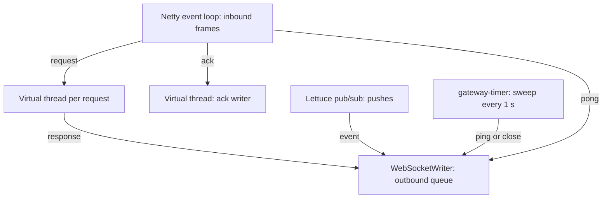

# Java backend

The Java backend is one binary with three roles, chosen by configuration: the gateway (WebSocket connections), the services (the conversation and sync services behind the internal RPC) and the fan-out worker (the Kafka consumer that fills the event logs and publishes pushes). It runs as a monolith with every role in one process, or split into gateways and services instances. Gateways in other languages can use its services instances, and its gateway can use theirs. It runs on JDK 25 with virtual threads, which no longer pin a carrier on `synchronized`. That is why plain blocking code (JDBC, blocking gRPC stubs, `Future.get`) is used throughout instead of a reactive style. Armeria over Netty serves the WebSocket endpoint, the internal gRPC and the operational endpoints. HikariCP over Connector/J talks to Vitess, the Kafka client consumes the outbox, and Lettuce talks to Valkey.

The data model, flows and guarantees common to every backend are in [docs/architecture.md](../../docs/architecture.md). This page covers how the Java code implements them.

## Layout

```text
src/main/java/wrinkle/
  Main.java          roles, the HTTP server, operational endpoints, shutdown
  Config.java        flags and environment
  Db.java            a HikariCP pool per keyspace
  Ids.java           derived ids: xxhash64, bit for bit as in the Go backend
  ApiError.java      contract error codes and their wire form
  Metrics.java       the shared metric names
  Sql.java, Timestamps.java   small JDBC and time helpers
  gateway/           WebSocket endpoint, one Conn per device, limits, push routing
  presence/          Valkey: device presence, the instance key, push channels
  services/          the Backend interface, in-process and over the RPC, the RPC server
  conversation/      sending, read marks, history, the outbox
  devicesync/        sign-in, devices, sync, conversation list, push tokens
  fanout/            Kafka consumer, outbox record parsing, the per-user log writer
src/test/java/wrinkle/   unit tests
```

The contract is generated at build time from the repository's [proto/](../../proto) by the Gradle protobuf plugin, with the gRPC stubs for `wrinkle.backend.v1`. Nothing generated is committed here.

## Roles and startup

[Main.java](src/main/java/wrinkle/Main.java) parses the configuration, opens what the roles need and starts one Armeria server:

- **Database pools** (`conversation` and `user` keyspaces) are opened when the process runs the services in any form: the `services` role, the `fanout` role, or a gateway without `--services`. Their `LocalBackend` wraps the two services.
- **gateway**: registers `/v1/ws` on the listen port. With `--services` it forwards over the RPC ([RpcClient](src/main/java/wrinkle/services/RpcClient.java)); without it, it calls `LocalBackend` in-process. It also starts the presence heartbeat and the connection sweep.
- **services**: adds a second port with the gRPC [RpcServer](src/main/java/wrinkle/services/RpcServer.java) on its own virtual host.
- **fanout**: starts the [FanoutWorker](src/main/java/wrinkle/fanout/FanoutWorker.java) on a platform thread named `fanout`, in the consumer group `wrinkle-fanout`.

Every process connects to Valkey ([Presence](src/main/java/wrinkle/presence/Presence.java)), even one that does not use it. `/healthz` and `/metrics` are served on the listen port in every role.

Configuration ([Config.java](src/main/java/wrinkle/Config.java)): flags have the same names and defaults as the Go backend. A flag takes `--name value` or `--name=value`, and overrides the environment.

| Flag | Environment | Default | Meaning |
|---|---|---|---|
| `--roles` | `WRINKLE_ROLES` | `gateway,fanout` | Comma-separated: `gateway`, `services`, `fanout` |
| `--listen` | `WRINKLE_LISTEN` | `:8080` | WebSocket, health, metrics, debug |
| `--services` | `WRINKLE_SERVICES` | empty | A gateway forwards to this RPC address instead of running the services in-process |
| `--services-listen` | `WRINKLE_SERVICES_LISTEN` | `:9000` | The RPC port of the `services` role |
| `--mysql` | `WRINKLE_MYSQL` | `127.0.0.1:15003` | vtgate's MySQL port |
| `--kafka` | `WRINKLE_KAFKA` | `localhost:19092` | Kafka brokers |
| `--valkey` | `WRINKLE_VALKEY` | `localhost:6379` | Valkey |
| `--node` | `WRINKLE_NODE` | the host name | Prefix of this process's instance id in presence |
| `--db-conns` | | `64` | Maximum connections in each of the two pools |

The default roles make a monolith: the gateway with the services in-process, and the fan-out.

## Connections

[Gateway.java](src/main/java/wrinkle/gateway/Gateway.java) is Armeria's `WebSocketServiceHandler`. It sets the frame limit to 64 KiB, so Armeria closes an oversized frame with 1009, and it aggregates continuation frames. Each upgrade gets a [Conn](src/main/java/wrinkle/gateway/Conn.java), which subscribes to the inbound frame stream and writes to an Armeria `WebSocketWriter`. A connection has no thread of its own. It runs on whatever thread delivers its work:



- **Reading.** The inbound stream delivers one frame at a time. After each frame `Conn` requests the next one (Reactive Streams demand). It stops requesting while 32 frames wait in the outbound queue, so a client that does not read its replies stops being read. Text frames close with 1003. A frame that does not parse, or an unexpected kind, closes with 1008.
- **Rate.** A [TokenBucket](src/main/java/wrinkle/gateway/TokenBucket.java) of 100 tokens that refills at 50 a second. Every frame takes a token, WebSocket pings and pongs included. Only the inbound thread touches it. A request without a token gets `ERROR_CODE_RESOURCE_EXHAUSTED`. Acks and pings without one are dropped.
- **Dispatch.** A request that is within the limits runs on a new virtual thread. In-flight requests per connection are capped at 32 (an `AtomicInteger`), and the 33rd gets `RESOURCE_EXHAUSTED`. `dispatch` applies the connection's state rules: Connect first, and only once. It then calls the `Backend` and queues the response. A `Backend` that throws (the services are unreachable, the RPC timed out) becomes `ERROR_CODE_UNAVAILABLE`. A successful Connect attaches the connection under its lock, which also rejects a second Connect that raced the first.
- **Acks.** An [AckCoalescer](src/main/java/wrinkle/gateway/AckCoalescer.java) writes one ack at a time, on a virtual thread. Acks that arrive during a write collapse into the highest pending cursor, which is written next. Acks before Connect are ignored. Failures are logged and not retried.
- **Writing.** Responses, pushes and pings go to the writer with `tryWrite`. A counter of queued frames goes down as each one is consumed. A push that finds 32 frames queued aborts the connection with 1013. Abort skips the frames still queued, so the close frame goes out next. The device syncs after it reconnects.
- **Liveness.** The sweep runs every second over all connections. It closes with 1008 a connection that has not connected within 5 seconds, and with 1001 one that has received nothing for 90 seconds. It sends a WebSocket ping when 30 seconds have passed since the last one. Clients may also send protobuf `Ping` frames, which get a `Pong`.

**Push delivery and presence.** [Connections](src/main/java/wrinkle/gateway/Connections.java) keeps every open connection and, for connected ones, a set per user. When a user's first connection attaches, the gateway subscribes to `push:<user_id>`, and it unsubscribes when the last one leaves. A message on that channel is an already serialized `Event`. `eventFrame` wraps it in a `Frame` without decoding it and queues it on each of the user's connections. Presence is a hash `presence:<user_id>` from device id to this process's instance id: the node name plus 8 random bytes in hex. A Lua script removes a device's entry only if it still names this instance, so a device that has reconnected elsewhere keeps its entry. The instance key `gateway:<instance>` is set with a 90 second expiry at start and refreshed every 30 seconds, so the entries of a process that dies without cleaning up stop counting within 90 seconds.

**Drain.** On SIGTERM or SIGINT, a shutdown hook sets the draining flag. `/healthz` then answers 503, and `/v1/ws` refuses upgrades with 503. The hook stops the fan-out consumer. It then drains the gateway: it stops the timer, closes every connection with 1001 and removes its presence, waits up to 5 seconds for in-flight requests to finish and connections to end, and deletes the instance key. Then it stops the server, closes Valkey and exits 0. A watchdog halts the process at 9.5 seconds if any step hangs.

## Services

[LocalBackend](src/main/java/wrinkle/services/LocalBackend.java) implements `Backend` by calling the two services for each request type. It turns any failure into the response's error body: `ApiError` with its code, anything else as `ERROR_CODE_INTERNAL` without detail. [RpcClient](src/main/java/wrinkle/services/RpcClient.java) implements the same interface over `wrinkle.backend.v1.BackendService`. It is a blocking Armeria gRPC stub on one HTTP/2 connection with a 10 second response timeout, and blocking costs nothing on the request's virtual thread. [RpcServer](src/main/java/wrinkle/services/RpcServer.java) serves `Call` and `Ack` and runs each on a virtual thread, off Armeria's event loop.

- **Conversation** ([ConversationService.java](src/main/java/wrinkle/conversation/ConversationService.java)) works against the `conversation` keyspace. `send` runs in one transaction: it locks the conversation row (`SELECT ... FOR UPDATE`), returns the stored message if the client message id was already used, and otherwise takes `last_seq + 1`. It then inserts the message and inserts and deletes an outbox row with the serialized `Event`. `markRead` locks the conversation and the read mark, ignores a mark that does not move forward, and writes the outbox row the same way. `messages` pages history newest first, 50 by default and at most 500. Outbox ids are random 63-bit ids.
- **Device sync** ([DeviceSyncService.java](src/main/java/wrinkle/devicesync/DeviceSyncService.java)) works against the `user` keyspace. `connect` derives the user id from the name ([Ids.java](src/main/java/wrinkle/Ids.java)), creates the user and the device if they are new, and returns the device's acked cursor and the log head. `open` checks that the peer exists under exactly that name, since the id is a hash, then creates the conversation and the caller's list entry. `sync` reads the log after a cursor, 100 events by default and at most 1000, and fetches one row extra to set `has_more`. `ack` moves `acked_position` forward with `GREATEST`. `registerPushToken` stores or clears an APNs token.

Pool connections are in autocommit mode; the operations that need a transaction turn it off and roll back on any failure.

**Fan-out** ([FanoutWorker.java](src/main/java/wrinkle/fanout/FanoutWorker.java), [UserLog.java](src/main/java/wrinkle/fanout/UserLog.java)) consumes `wrinkle.conversation.outbox` with auto-commit off.

- **Ordering.** Each polled batch is split by partition and then by record key, the conversation id. Each conversation's records run in offset order on a virtual thread, and different conversations run in parallel. Within a record, the two participants' appends run in parallel. Each user's log is serialized by its row lock, whatever the interleaving.
- **Append.** One transaction locks `user.log_head`, inserts the event at `log_head + 1` and advances the head. For a message it upserts the conversation list entry, and for a read event it moves `read_seq` or `peer_read_seq` forward. After the commit it publishes the event, with its cursor set, to `push:<user_id>`. A redelivered record hits the unique key on the source outbox row and is skipped. Peer names are cached for good, since names never change.
- **Retries and commit.** A record is tried 5 times, with 200 ms times the attempt number between tries. A batch is committed (`commitSync`) only when every record in it was delivered. Otherwise the consumer seeks back to the first offset of each partition, waits a second and polls the same records again. A record that cannot be parsed, or has no event body, is logged and skipped.
- **Push notifications.** None: the fan-out does not consult presence and sends nothing to APNs; see Gaps.

## Metrics and debug endpoints

On the listen port of every role:

- `/metrics`: Prometheus exposition of [Metrics.java](src/main/java/wrinkle/Metrics.java) and the JVM metrics from the Prometheus client's JVM instrumentation. The names are in [docs/metrics.md](../../docs/metrics.md). `wrinkle_push_sent_total` is absent, since this backend does not push.
- `/healthz`: `ok`, or 503 while draining.
- `/debug/gc`: runs `System.gc()`, so a measurement can sample memory after a collection. Everything under `/debug/` answers only to loopback addresses and returns 403 to anyone else.

The JVM exporter reports no resident memory on macOS, so the load generator reads RSS with `ps`.

## Building, running, testing

Gradle runs with a JDK 25 toolchain, found through `java_home` by the Makefile. It compiles with `-Xlint:all -Werror` and checks formatting with google-java-format through Spotless.

| Target | What it does |
|---|---|
| `make build-java` | `gradlew installDist`, into `build/install/wrinkle` |
| `make run-java-mono` | all roles in one process on :8080 |
| `make run-java-services` | a services and fan-out instance for the balancers (`INSTANCE=n`: RPC on 9100+n, metrics on 8190+n) |
| `make run-java-gw` | a gateway on :8183, forwarding through the services balancer |
| `make conformance-java-mono`, `conformance-java-gw` | the conformance tests against either shape |
| `make measure-java-mono`, `measure-java-gw` | the measurement protocol |
| `make java-lint`, `java-test` | Spotless and compile; unit tests (both in `make lint`, `make test`, `make ci`) |
| `make format` | includes `spotlessApply` |
| `make cluster-up JAVA_SERVICES=n JAVA_GW=n` | Java instances in the container cluster, from the [Dockerfile](Dockerfile) |

[split.sh](split.sh) runs a Java gateway beside a Java services process through [../beside-services.sh](../beside-services.sh). The services take `--roles services,fanout` on 127.0.0.1:8090 and :9000, and the gateway gets `WRINKLE_SERVICES`. On exit the gateway stops first, so it drains while the services still answer. [../services.sh](../services.sh) and [../gateway.sh](../gateway.sh) start the side-by-side instances.

Unit tests: [IdsTest](src/test/java/wrinkle/IdsTest.java) checks the ids against values computed by the Go backend, for every input length class, and checks symmetry and the 63-bit range. [TokenBucketTest](src/test/java/wrinkle/gateway/TokenBucketTest.java) covers capacity, refill and the cap. [AckCoalescerTest](src/test/java/wrinkle/gateway/AckCoalescerTest.java) checks one write at a time, that the highest pending cursor wins, and restarting after idle. Everything else is covered by the conformance tests.

## Measured

On 2026-10-11, from a fresh stack ([2026-10-11-gateways.md](../../docs/results/2026-10-11-gateways.md)), the Java monolith delivered 500 messages per second at 87 ms p50 and 230 ms p99 end to end, and held 4000 idle connections in 398 MiB, against 312 MiB at 500. Earlier runs: [2026-10-10-java.md](../../docs/results/2026-10-10-java.md), [2026-10-10-go-vs-java.md](../../docs/results/2026-10-10-go-vs-java.md), [2026-10-10-idle-memory.md](../../docs/results/2026-10-10-idle-memory.md). The split shape (`java-gw`) has no results yet.

## Gaps

- The fan-out sends no push notifications. Tokens are stored, but in a mixed pool the partitions a Java instance consumes get no APNs pushes.
- Acks are written as they come, one at a time per connection. They are not coalesced to one write a minute (open for every gateway in ROADMAP.md).
- `MessageFailedEvent` is never produced, as in every backend.
- The services role has no drain of its own: it stops the consumer and the server on shutdown, with no wait for RPCs in flight beyond what Armeria's stop does.
- The JVM's live memory figure leaves out Netty's direct buffers, so compare the RSS slope.
