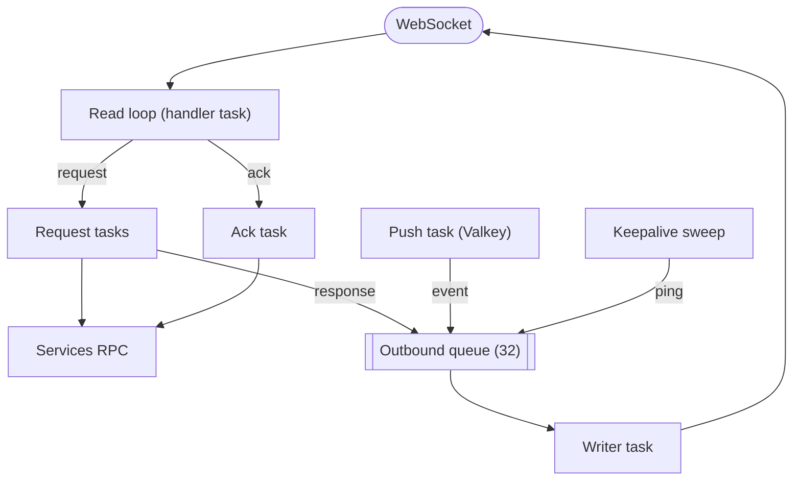

# Rust gateway

The Rust implementation is a gateway only: it holds the devices' WebSocket connections, enforces the contract's per-connection limits, forwards every request to a Go or Java services process over the internal RPC (`proto/wrinkle/backend/v1`), and delivers pushes that the fan-out publishes to Valkey. It runs beside a services process, never alone. It is built on tokio, with axum for HTTP and WebSocket, tonic and prost for the RPC and the contract, and redis-rs for Valkey. ROADMAP.md explains why Elixir and Rust implement only the gateway: connection handling is where the languages differ most, while the services are SQL and a Kafka consumer. The overall architecture, its flows and its guarantees are in [docs/architecture.md](../../docs/architecture.md); this page covers how this code realizes them.

## Layout

```text
Cargo.toml        dependencies; release builds keep line-level debug info
build.rs          generates the contract from ../../proto with a vendored protoc
src/main.rs       configuration, startup, routes, health, drain on shutdown
src/conn.rs       one connection: read loop, writer, requests, limits, keepalive sweep
src/ack.rs        a connection's acks, forwarded once per interval and on close
src/push.rs       Valkey pub/sub: one channel per user, delivery to its connections
src/presence.rs   the presence hash and this instance's expiring key
src/metrics.rs    the shared metric names in the Prometheus text format
src/user_id.rs    16-byte user ids and their lowercase hex, which names users in Valkey
run.sh            this gateway beside a Go services process
Dockerfile        the image for the cluster
```

The generated code is not committed; [build.rs](build.rs) compiles `wrinkle/v1/frame.proto` and `wrinkle/backend/v1/services.proto` (client side only) at build time, and [main.rs](src/main.rs) includes it as `pb::v1` and `pb::backend::v1`.

## Roles and startup

There are no roles to choose: the binary is always a gateway. [main.rs](src/main.rs) reads its configuration from the environment, connects to Valkey, and then listens; the services are reached on first use.

| Variable | Default | Meaning |
|---|---|---|
| `WRINKLE_LISTEN` | `:8080` | `host:port` to listen on; `:port` means every interface |
| `WRINKLE_SERVICES` | `localhost:9000` | The services RPC, or the services balancer |
| `WRINKLE_VALKEY` | `localhost:6379` | Valkey, for presence and pushes |
| `WRINKLE_NODE` | the host name | The node part of the instance id |
| `WRINKLE_ACK_INTERVAL_MS` | `60000` | How often a device's acks are forwarded; `0` forwards each as it comes |
| `RUST_LOG` | `info` | The `tracing` filter, used as given when set |

Startup, in order:

1. One tonic `Channel` to the services, made with `connect_lazy`: it connects on the first request and again after losing the connection, each attempt bounded at 3 seconds, so the gateway starts and serves while the services are not up yet, and requests answer `UNAVAILABLE` until they are. Every request clones the channel, which multiplexes them over one HTTP/2 connection.
2. A presence handle on a Valkey `ConnectionManager`, which writes the instance key once before going on, so Valkey has to be up at startup (see Presence below). Every command on it, and every connection attempt, is bounded at 5 seconds, like the pub/sub connection's.
3. A push handle and its task, which makes the dedicated pub/sub connection itself.
4. Two background tasks: the keepalive sweep and the presence heartbeat.
5. The axum server, with graceful shutdown wired to the drain.

## Connections

Each connection is served on the task axum gives its upgrade handler, plus a writer task and a task per request. The upgrade sets the size limits (64 KiB per message and frame), a 1 KiB read buffer and no write buffering, and refuses new connections with 503 while draining.



The pieces, in [conn.rs](src/conn.rs) but for the acks:

- `Link` is what other tasks hold: the sender of the bounded outbound queue (32 entries), a one-shot close signal, the connection id and when it last received anything. `Conns` keeps every `Link` by id for the sweep and the drain, and counts requests in flight across the gateway.
- The read loop is a `select!` over the next WebSocket message, the Connect deadline and the writer ending. Any message refreshes the last-seen time. Binary messages are decoded as `Frame`; text closes with 1003, a frame over the limit (tungstenite's capacity error) with 1009, a malformed frame or a server-side frame kind with 1008.
- The writer task drains the queue to the socket. When the close signal fires it stops writing and sends the close frame, giving it 3 seconds; the first close wins, later ones are ignored. A failed socket write ends it with a 1011 close frame, given the same 3 seconds. A close frame from the device signals a 1000 close the same way, which makes the writer flush the echo tungstenite has queued, completing the handshake. When the read loop ends without a close, `Link::finish` drops the signal so the writer stops without a frame.
- Each request runs in its own `tokio::spawn`ed task. `dispatch` applies the state rules (before Connect, only Register, SignIn and Connect are forwarded, with an empty user id, and anything else is `UNAUTHENTICATED` "connect first"; after it, Register, SignIn and Connect are `FAILED_PRECONDITION` "already connected"), then calls `BackendService.Call` with the bound user and device. A Connect response without a 16-byte user id answers `INTERNAL`. A call taking over 10 seconds, or failing, answers `UNAVAILABLE` with the request's id. A successful Connect response binds the connection and is sent once the user's push channel is subscribed; if another Connect bound it first, this one gets `FAILED_PRECONDITION` instead, and if the subscription is not in place within 5 seconds, the binding is undone and the Connect answers `UNAVAILABLE`, and may be retried.
- Responses wait for room in the queue, which holds back the device's own requests; pushes do not wait (see Push delivery).

The limits and their values are the contract's ([frame.proto](../../proto/wrinkle/v1/frame.proto)); this is how the gateway enforces them:

| Limit | How |
|---|---|
| Frame size | axum's `max_message_size` and `max_frame_size`; close 1009 |
| Rate | a `TokenBucket` per connection, owned by the read loop; every decoded protobuf frame takes a token, WebSocket control frames none. A request without one fails with `RESOURCE_EXHAUSTED`; an ack or ping without one is dropped |
| Requests in flight | an atomic counter per connection; beyond it, `RESOURCE_EXHAUSTED` |
| Connect deadline | a timer in the read loop, restarted when a Register or SignIn is answered (hashing the password takes a while) or a Connect is undone; if the connection is not bound when it fires, close 1008 |
| Acks once per interval | `Acks` in [ack.rs](src/ack.rs), created on the first ack after Connect: the first is written at once, later ones raise a pending cursor, written by the same task an interval after the last write started, one write at a time; when the connection ends, the pending cursor is written at once. A connection that never acks has no task |
| Pings and the idle timeout | the gateway-wide sweep runs every 10 s, closes connections idle for 90 s with 1001, and every third sweep queues a WebSocket ping (skipped if the queue is full) |
| Keeping up with events | a full queue on push closes with 1013 |

Application-level `Ping` frames get a `Pong`; client `Pong` frames are ignored. Rejected requests are still counted in the request metrics.

### Push delivery

[push.rs](src/push.rs) holds a registry from user id to the `Link`s of that user's connections on this gateway, and one Valkey pub/sub connection owned by a single task. The registry is the desired state: a user with a connection here should have `push:<hex of the user id>` subscribed. Attach and detach change it under a short lock, never held across a Valkey call, and send the user id to the task over an unbounded channel; the task compares the registry with the channels it has subscribed and issues `SUBSCRIBE` or `UNSUBSCRIBE` until they match, so an attach racing the user's last detach cannot leave the user unsubscribed. An attach also hands the task a one-shot that it answers once the channel is subscribed, which the Connect response waits for.

If the pub/sub connection drops (the message stream ends, or a command fails or takes over 5 seconds), the task makes a new one with backoff from 100 ms doubling to 5 seconds, and subscribes every user in the registry; attaches arriving meanwhile wait for that. Each message is a serialized `wrinkle.backend.v1.Push`. Its `event` is wrapped as a `Frame` without decoding the `Event`: a `Push` holding only an event differs from that `Frame` only in the field tag (`Push.event` is field 1, `Frame.event` field 3), so the common case copies the payload with the tag byte swapped, and anything else goes through prost and is prefixed with the tag of `Frame.event` and its length. A `signed_out` closes the user's connections whose device id is listed (the registry keeps each `Link` with its device id), or all of them for `all_devices`, with 4001 "signed out". A message that does not decode is logged and dropped. The frame goes to every connection of the user with `try_send`, and `wrinkle_events_pushed_total` counts only those it queues; a full queue closes that connection with 1013, and the device syncs on reconnect.

### Presence

[presence.rs](src/presence.rs) keeps the hash `presence:<hex of the user id>`, device id to instance id. The instance id is `<node>/<16 random hex digits>`, so a restarted process is a new instance. The key `gateway:<instance>` is set with a 90 second expiry at startup and refreshed every 30 seconds; the services treat entries whose instance key is gone as not connected. A bound connection sets its field; on detach a Lua script deletes the field only if it still names this instance, so a device that has reconnected elsewhere keeps its entry. The `ConnectionManager` reconnects after a dropped connection; a write that fails on one is retried once, a write that times out (5 seconds) is not, and a write that still fails is logged as a warning, so a stalled Valkey delays a Connect by at most 5 seconds. Binding and the end of a connection can race; `Binding` (`Pending`, `Bound`, `Gone`) makes sure that whichever comes second undoes the push registration and the presence entry.

### Drain

On SIGTERM or SIGINT [main.rs](src/main.rs) stops the sweep and the heartbeat, then `Conns::drain` marks the gateway draining (health check and upgrades answer 503) and closes every connection with 1001. It waits up to 5 seconds for every connection to detach and every request and final ack write in flight to finish, deletes the instance key, and gives the HTTP server 3 seconds to stop. A request still running when the grace ends is not cancelled: its task lives on until the services answer or the 10 second call timeout passes, and its response is dropped since the connection is gone; this is intended, so the drain need not track those tasks.

## Metrics and debug endpoints

On the listening port:

- `GET /v1/ws`: the WebSocket endpoint.
- `GET /healthz`: `ok`, or 503 `draining`.
- `GET /metrics`: written by hand in [metrics.rs](src/metrics.rs): `wrinkle_connections`, `wrinkle_events_pushed_total`, `wrinkle_requests_total` and `wrinkle_request_duration_seconds` by request type, plus `process_cpu_seconds_total` from `getrusage` and `process_resident_memory_bytes` from the `memory-stats` crate. Names and meanings are in [docs/metrics.md](../../docs/metrics.md).
- `POST /debug/gc`: answers `ok` and does nothing, since there is no collector; the load generator calls it on every backend before reading memory. Only loopback peers reach it; others get 403.

There is no live-memory metric and no profiling endpoint.

## Building, running, testing

| Target | What |
|---|---|
| `make build-rust` | `cargo build --release` |
| `make run-rust-gw` | the gateway on :8182 for the side-by-side setup, through [gateway.sh](../gateway.sh); needs `make lb-up` and a services instance |
| `make conformance-rust-gw` | the conformance tests against [run.sh](run.sh), this gateway beside a Go services process |
| `make measure-rust-gw` | the measurement protocol, from a fresh stack; results labeled `rust` |
| `make rust-lint` | `cargo fmt --check` and `cargo clippy --release -- -D warnings` |
| `make rust-test` | the unit tests |
| `make cluster-up RUST_GW=n` | n gateways in containers, from the [Dockerfile](Dockerfile) |

[run.sh](run.sh) hands the release binary to [beside-services.sh](../beside-services.sh), which starts Go services and fan-out on 127.0.0.1:9000 and 8090, waits for them, and runs the gateway on :8080; on exit it stops the gateway first so it drains while the services still answer.

The unit tests are small: the listen address, the token bucket's burst and refill, the ack interval and its coalescing on paused time, the instance id format, and the event wrapping across varint length boundaries, checked by decoding the result as a `Frame`. Everything that involves a connection is left to the conformance tests.

## Measured

On 2026-10-21 at commit 607dcfd ([2026-10-21-shapes.md](../../docs/results/2026-10-21-shapes.md), raw runs in [2026-10-21-rust.jsonl](../../docs/results/2026-10-21-rust.jsonl)), medians of three: at 1000 connections, 66 ms p50 and 127 ms p99 end to end at 500 messages per second and 167 / 510 ms at 1000, every message delivered, with 201 ms of gateway CPU per 1000 messages at 500 and 31 MiB resident, the least of the four gateways on every count. Idle, 4000 connections took 47 to 112 MiB resident across the repetitions, from a baseline of a few megabytes; the allocator returns memory unevenly. Earlier rounds: [2026-10-15-shapes.md](../../docs/results/2026-10-15-shapes.md), [2026-10-11-gateways.md](../../docs/results/2026-10-11-gateways.md).

## Gaps

- Gateway only: services and fan-out in Rust are open in [ROADMAP.md](../../ROADMAP.md). Pushes to devices that are not connected depend on the services beside it, which only the Go ones send.
- No live-memory figure and no profiling endpoints; `/debug/gc` exists only so the load generator can call it.
- No limits per user or per address, as in every gateway; they need shared state.
- A Valkey restart loses the presence entries of devices that stay connected; they are written again only when each device reconnects. The instance key comes back with the next heartbeat.
