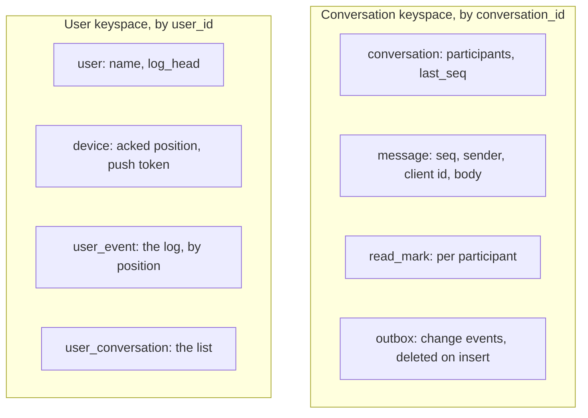
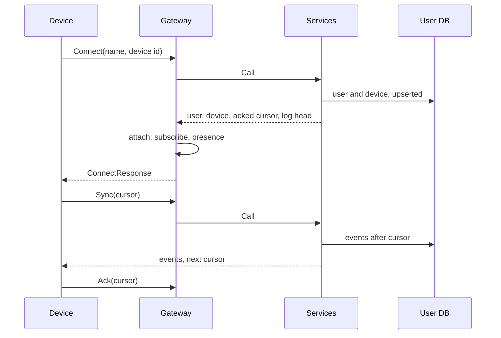
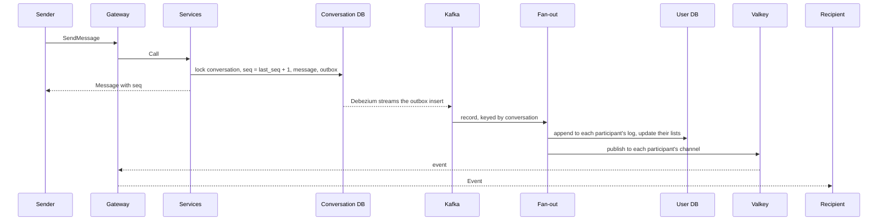

# Architecture

How Wrinkle is put together, independent of the language a backend is written in. The [README](../README.md) gives the short version; each backend's README describes its own code: [Go](../backends/go/README.md), [Java](../backends/java/README.md), [Elixir](../backends/elixir/README.md), [Rust](../backends/rust/README.md). The design is sized for the figures in [capacity.md](capacity.md), and design choices are weighed at that scale, even where a small deployment could do with less.

## Principles

- **Per-conversation sequence.** A conversation numbers its messages 1, 2, 3, ... in the transaction that stores each one. Every device orders a conversation by that number and can tell when it misses one.
- **Per-user event log.** Everything a user's devices need to learn, messages and read marks from all of the user's conversations, is appended to one log per user. A device keeps one cursor into it.
- **Push is an optimization, sync is the guarantee.** Connected devices get events as they are appended. A device that missed some reads them from its log after its cursor.
- **The contract is the boundary.** The device protocol in [`proto/wrinkle/v1`](../proto/wrinkle/v1) is the same for every backend, and the conformance tests in [`conformance/`](../conformance) hold each backend to it. Clients and the load generator work against any backend unchanged.

## Processes

| Process | Holds | State | Scales by |
|---|---|---|---|
| Gateway | devices' WebSocket connections | connections in memory; presence in Valkey | more gateways behind the device balancer |
| Services | conversation and device-sync request handling | none; all in the databases | more instances behind the services balancer |
| Fan-out | the outbox stream from Kafka | consumer offsets in Kafka | partitions of the topic, shared by one consumer group |
| Conversation DB | conversations, messages, read marks, the outbox | sharded by conversation id | Vitess shards |
| User DB | users, devices, event logs, conversation lists | sharded by user id | Vitess shards |
| Kafka and Debezium | committed outbox rows, in commit order per conversation | the topic | partitions |
| Valkey | presence, push channels, gateway instance keys | in memory, rebuildable | cluster or more instances |

The fan-out runs inside the services processes. A gateway, the services and the fan-out can also run as one process, the monolith, in which the gateway calls the services directly.

### Shapes

| Shape | What runs | Used for |
|---|---|---|
| Monolith | one process with every role (Go, Java) | the simplest run; conformance and measurement |
| Split | a gateway and a services process beside it, no balancers | conformance and measurement of a gateway (all four languages) |
| Side by side | any number of gateways and services instances on the host, two HAProxy balancers in Docker | the scaled shape, natively ([local-network.md](local-network.md)) |
| Cluster | the same in containers, counts per language and role | trying the scaled shape without native toolchains |

## Data model

Two Vitess keyspaces, each sharded by the id that every query of it carries, so a request touches one shard of each keyspace it needs. The schemas are in [`schema/`](../schema).

Ids are derived, not allocated, so that sign-in and opening a conversation need no lookup table:

- **User id**: a 63-bit xxhash64 of the name.
- **Conversation id**: a 63-bit hash of the two user ids, smaller first; both participants derive the same id.
- **Device and outbox ids**: random 63-bit numbers.

Go and Java compute the hashes bit for bit alike (Java's unit test holds Go's values), so both work on the same data; the Elixir and Rust gateways never compute ids.

## Flows

### Connect and sync

Connect must be the first request; until it completes, the gateway answers anything else with `UNAUTHENTICATED`, and after 5 seconds without it the gateway closes the connection. The response carries the cursor the device last acked and the head of the user's log, so a device knows at once how far behind it is. Sync pages through the log, up to 1000 events at a time.

### Sending a message

1. **Store.** The services lock the conversation's row, take the next sequence number, insert the message and an outbox row, delete the outbox row again and commit: one local transaction on the conversation's shard. A resend with the same `client_message_id` finds the stored message and returns it instead of storing a second one.
2. **Capture.** Debezium reads the shard's change stream and publishes the outbox insert to Kafka, keyed by conversation id, and skips the delete. The row lives only within the transaction; the change stream is what carries it, so the event is published exactly when the transaction commits.
3. **Fan out.** A fan-out worker takes the record and, for each participant (the sender too, for their other devices), appends the event to the participant's log at the next position and updates their conversation list, in one transaction on the participant's shard.
4. **Push.** After the append, the worker publishes the event, now carrying its log position, to the participant's Valkey channel. Each gateway holding one of that user's devices is subscribed to the channel and writes the event to those connections.
5. **Notify.** For a recipient's devices that are not connected and have registered for push, the Go fan-out sends an APNs notification.

The sender's response returns after step 1; everything after it is asynchronous. End to end, send to receipt on a connected device, takes about 100 ms at the median in the measurements ([results](results/)).

### Read marks

`MarkRead` moves the user's read position in the conversation forward, never back, and writes an outbox row like a message. Fan-out appends a read event to both participants' logs: the peer learns the message was read, and the user's other devices learn what was read elsewhere.

### Acks

A device acks the cursor it has processed. The gateway writes it to the device's row, at most one write at a time per connection, keeping only the highest cursor that arrived meanwhile. The next Connect returns it, so a device that lost its local state can resume.

## Guarantees

- **Order within a conversation.** Sequence numbers are dense and assigned under the conversation's row lock. Debezium publishes a shard's changes in commit order, all of a conversation's records go to one Kafka partition, and a fan-out worker handles one conversation's records in order, so each participant's log has them in sequence order.
- **At least once, without duplicates.** A fan-out worker commits its Kafka offsets only after every record of a batch is in every log; a failed batch is fetched again. A redelivered record finds its source key (conversation id and outbox id) already in the log and is skipped.
- **Idempotent sends.** The client's message id makes a retried send return the original message.
- **Nothing lost to a missed push.** Pushes go only to devices connected at the moment; anything a device did not receive is in its log, and Sync from its cursor returns it.
- **Monotonic positions.** Read positions and acked cursors only move forward.

## Connections

The rules every gateway enforces are in the contract, in [`frame.proto`](../proto/wrinkle/v1/frame.proto):

- Frames up to 64 KiB; Connect within 5 seconds.
- Per connection, 50 frames a second on average in bursts of 100, and 32 requests in flight. Requests beyond the limits get `RESOURCE_EXHAUSTED`; other frames beyond them are dropped.
- WebSocket pings every 30 seconds; a connection silent for 90 seconds is closed.
- Each way a connection ends has a close code, and clients reconnect with backoff after any of them, then sync.
- A device that does not keep up with its pushed events is closed rather than buffered for; it syncs on reconnect.

### Presence

Each gateway process has an instance id, its node name and a random suffix, and keeps a Valkey key for it alive with a 90-second expiry, refreshed every 30 seconds. A user's presence hash maps each connected device to the instance holding it. A reader, the push notifier, counts a device as connected only while its instance key exists, so the devices of a gateway that died count as disconnected within 90 seconds and get notifications again. A disconnect removes the device's entry only if it still names this instance, so a device that has already reconnected elsewhere keeps its new entry.

Pushes use one Valkey channel per user; a gateway subscribes to a user's channel while it holds one of the user's devices.

### Drain

On SIGTERM a gateway fails its health check, so the balancer stops sending it connections, and refuses new ones itself. It closes every connection with 1001, which the clients take as a cue to reconnect, through the balancer to another gateway. It gives requests in flight up to 5 seconds and exits within 10.

## The internal RPC

A gateway that does not run the services in-process forwards each device request over gRPC ([`proto/wrinkle/backend/v1`](../proto/wrinkle/backend/v1)): the request as the device sent it, with the user and device the connection belongs to, and gets back the response as it goes to the device. The gateway owns the connection state: it enforces Connect first and remembers the identity Connect established. Acks have their own call. Pushes do not use the RPC; they go through Valkey.

Each gateway keeps one HTTP/2 connection to the services balancer, which spreads requests, not connections, over the services instances. A balancer that spread connections would pin each gateway to one instance.

## Failures

| What fails | Effect | Recovery |
|---|---|---|
| A gateway | its devices disconnect | they reconnect through the balancer to another gateway and sync; presence entries expire within 90 s |
| A services instance | requests in flight on it fail with `UNAVAILABLE` | the balancer drops it within 2 s; Kafka moves its fan-out partitions to the other instances |
| Kafka or Debezium | sends still succeed; nothing is fanned out | the stream resumes from where it was; the logs catch up and devices get the events then |
| Valkey | no pushes; presence unknown | devices still sync; pushes resume when it is back, and gateways announce themselves again |
| APNs | no notifications | none needed; devices sync when opened |
| A conversation shard | sends and reads in its conversations fail | the shard's replica takes over (a real Vitess topology; the prototype runs one process) |
| A user shard | Connect, Sync and fan-out to its users fail | fan-out retries the batch until the shard is back |

The prototype's single Vitess process has one known weakness: after a restart on existing data the change stream does not resume until the stack is reset ([ROADMAP.md](../ROADMAP.md), "Later").

## Scaling

- **Connections** scale with gateways: each holds its devices in tens of KiB per connection ([capacity.md](capacity.md)), and the device balancer sends each new connection to the gateway with the fewest.
- **Requests** scale with services instances, which hold no state.
- **Writes** scale with shards. A send is one transaction on one conversation shard; its fan-out is one transaction per participant on their user shards.
- **Fan-out** scales with Kafka partitions, keyed by conversation, so different conversations proceed in parallel and each stays in order.
- **The database** is where a laptop runs out first: above about 500 messages a second the single Vitess process limits every backend ([ROADMAP.md](../ROADMAP.md), "Database ceiling").

Where the prototype departs from the design it was sized on, push routing through a channel per user and frequent acks, is listed in [capacity.md](capacity.md).

## Implementations

| | Gateway | Services and fan-out | Push |
|---|---|---|---|
| [Go](../backends/go/README.md) | goroutines, coder/websocket | database/sql, franz-go | APNs |
| [Java](../backends/java/README.md) | Armeria on Netty, virtual threads | HikariCP, the Kafka client | not yet |
| [Elixir](../backends/elixir/README.md) | Bandit, a process per connection | beside Go or Java services | through the services |
| [Rust](../backends/rust/README.md) | axum on tokio, a task per connection | beside Go or Java services | through the services |

Clients: the [web client](../clients/web) in React and TypeScript, the [iOS client](../clients/ios) in SwiftUI with local storage, and the [Go client library](../clients/go) the conformance tests and the load generator use.
