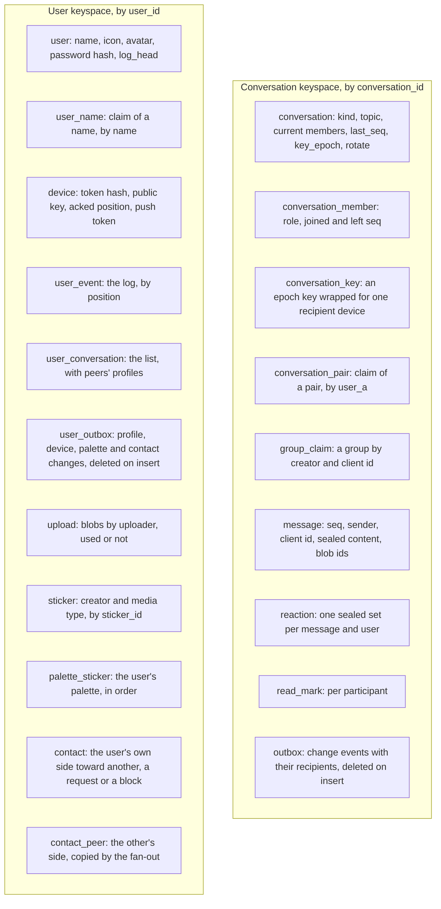
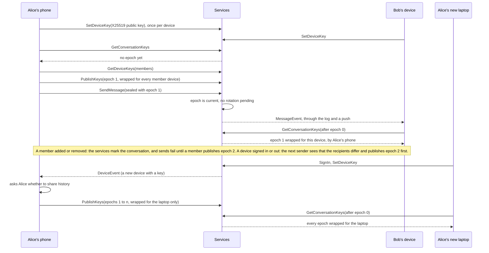
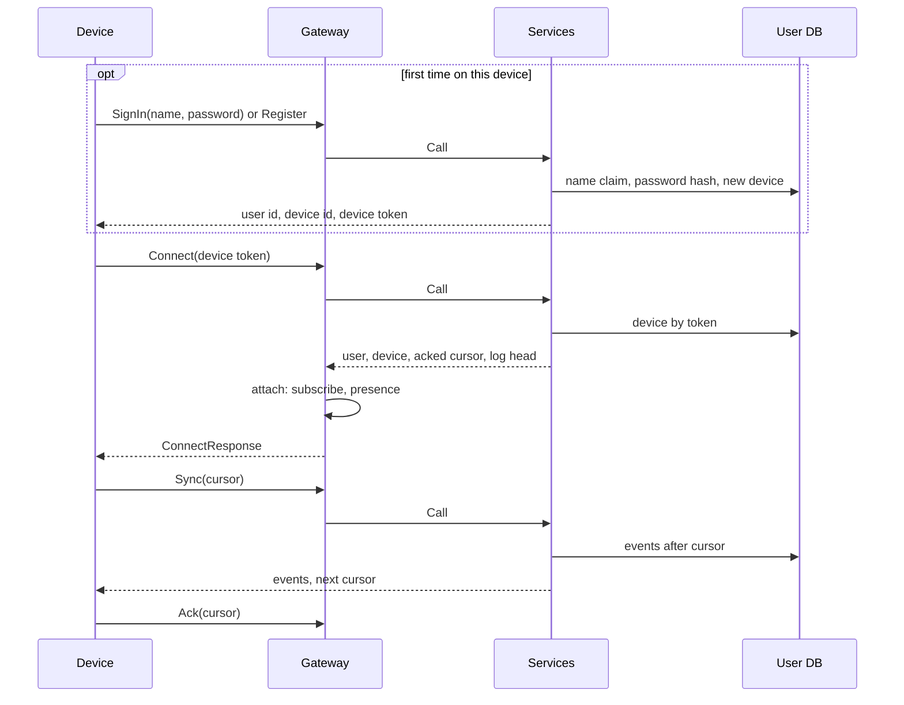
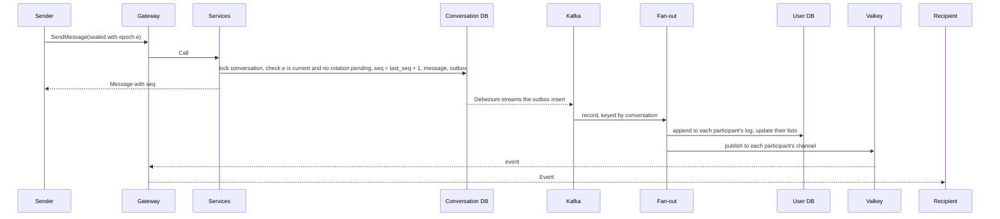
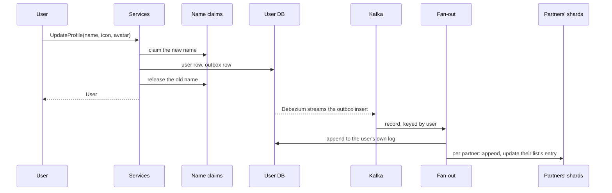

# Architecture

How Wrinkle is put together, independent of the language a backend is written in. The [README](../README.md) gives the short version; each backend's README describes its own code: [Go](../backends/go/README.md), [Java](../backends/java/README.md), [Elixir](../backends/elixir/README.md), [Rust](../backends/rust/README.md). The design is sized for the figures in [capacity.md](capacity.md), and design choices are weighed at that scale, even where a small deployment could do with less.

## Principles

- **Per-conversation sequence.** A conversation numbers its messages 1, 2, 3, ... in the transaction that stores each one. Every device orders a conversation by that number and can tell when it misses one.
- **Per-user event log.** Everything a user's devices need to learn is appended to one log per user: messages, read marks, deletions and reactions from all of the user's conversations, and changes to the user's profile, devices and sticker palette (the event kinds in [`event.proto`](../proto/wrinkle/v1/event.proto)). A device keeps one cursor into it.
- **Push is an optimization, sync is the guarantee.** Connected devices get events as they are appended. A device that missed some reads them from its log after its cursor.
- **The contract is the boundary.** The device protocol in [`proto/wrinkle/v1`](../proto/wrinkle/v1) is the same for every backend, and the conformance tests in [`conformance/`](../conformance) hold each backend to it. Clients and the load generator work against any backend unchanged.

## Choices

- **Debezium over a relay.** The services could produce to Kafka themselves, from an outbox they poll. A relay gives the same guarantee with fewer moving parts, but it loses the order of a conversation's events unless it polls each shard in order, has to be written in every services language, and must follow resharding by itself. Reading the change log keeps commit order for free, which at the scale the design aims for outweighs the extra process.
- **Requests balanced one at a time.** Each gateway keeps one HTTP/2 connection to the services. A balancer that spread connections would pin each gateway to one services instance, so the services balancer is HAProxy in HTTP/2 mode, which spreads requests. Client-side balancing in each gateway would save the hop but needs doing in three gRPC clients of uneven support.
- **No Kubernetes.** Its Services balance connections too, so it would not replace HAProxy for the RPC, and it would add image builds and networking layers to a project whose point is comparing processes measured natively. The cluster is plain Compose.
- **A key per conversation and epoch** for end-to-end encryption, rather than an established protocol: simple enough to follow end to end and the same for two users and for groups. MLS could replace it behind the same requests ([below](#end-to-end-encryption)).

## Processes

| Process | Holds | State | Scales by |
|---|---|---|---|
| Gateway | devices' WebSocket connections | connections in memory; presence in Valkey | more gateways behind the device balancer |
| Services | the conversation service and the sync service | none; all in the databases | more instances behind the services balancer |
| Fan-out | the outbox stream from Kafka | consumer offsets in Kafka | partitions of the topic, shared by one consumer group |
| Conversation DB | conversations, messages, read marks, reactions, wrapped keys, the outbox | sharded by conversation id | Vitess shards |
| User DB | users, devices, event logs, conversation lists, uploads, stickers and palettes | sharded by user id | Vitess shards |
| Kafka and Debezium | committed outbox rows of both keyspaces, in commit order per conversation or user | the topics | partitions |
| Valkey | presence, push channels, gateway instance keys | in memory, rebuildable | cluster or more instances |
| Object storage | blobs: avatars, stickers, encrypted attachments | Garage locally behind a proxy; S3 or GCS in production | the storage service |

The services are two, split by keyspace. The conversation service owns the conversation keyspace: sends, read marks, groups, deletions, reactions and key epochs. The sync service owns the user keyspace: accounts, devices and profiles, sync and conversation lists, uploads, stickers and push tokens; the code splits it further (accounts, uploads and stickers are packages of their own in Go, Java and TypeScript). The fan-out runs inside the services processes. A gateway, the services and the fan-out can also run as one process, the monolith, in which the gateway calls the services directly.

### Shapes

| Shape | What runs | Used for |
|---|---|---|
| Monolith | one process with every role (Go, Java) | the simplest run; conformance and measurement |
| Split | a gateway and a services process beside it, no balancers | conformance and measurement of a gateway (all four languages) |
| Side by side | any number of gateways and services instances on the host, two HAProxy balancers in Docker | the scaled shape, natively ([local-network.md](local-network.md)) |
| Cluster | the same in containers, counts per language and role | trying the scaled shape without native toolchains |

## Data model

Two Vitess keyspaces, each sharded by the id that every query of it carries, so a request touches one shard of each keyspace it needs. Four tables are sharded by something else: the three claim tables by what they are looked up by (names; pairs of users by the first user; groups by their creator), and `sticker` by the sticker's id, since stickers are public and outlive their creator. The schemas are in [`schema/`](../schema).

Ids:

- **User and conversation ids**: random UUIDs, 16 bytes. Nothing about a user or a conversation is derived from its name or members, so names change freely and a conversation can have any members.
- **Blob and sticker ids**: random UUIDs too; a sticker's id is its blob's.
- **Device and outbox ids**: random 63-bit numbers.
- **Valkey keys** name a user by the lowercase hex of the id.

Claims make the lookups that ids no longer answer, each sharded by its own key, without a transaction across shards:

- **Names.** `user_name` maps a name to its user, unique ignoring case: the column's collation compares case-insensitively and its vindex hashes case-insensitively, so "Bob" and "bob" meet on one shard and collide. A claim counts only while its user's row still has that name; one left behind by an interrupted registration or rename is stale, and the next claimant takes it over. Registering writes the user first, then the claim; renaming claims the new name, commits the change, then releases the old one. Every step can be interrupted without leaving a name owned twice or a user without a valid claim to their current name.
- **Pairs.** `conversation_pair` maps two users, smaller id first bytewise, to their conversation, sharded by the first user. The first opener's insert claims the pair; both opening at once end up with the same conversation. A claim whose conversation row is missing is completed by the next open. A user's notes are the pair of the user with themselves, so two devices opening them at once end up with the same notes too.
- **Groups.** `group_claim` maps a creator and the client's group id to the group, so a retried CreateGroup finds the group the first attempt made.

Go, Java and TypeScript implement all of this, and the password and token formats, alike (unit tests in each hold the same vectors), so all three work on the same data; the Elixir and Rust gateways only carry ids.

## Accounts

- **Register** takes a name, a password and a device name; **SignIn** the same for an existing account, matching the name ignoring case. Both return the device's credentials: user id, device id and a device token. Only they and Connect are allowed before Connect.
- **Passwords** are stored as argon2id hashes (19 MiB, 2 passes) in the standard string form, which records its parameters, so they can be raised later. A wrong name and a wrong password get the same answer, in the same time.
- **Device tokens** are `v1.` and the base64url of the user id, the device id and a 32-byte secret; the device row keeps a SHA-256 of the secret. Connect with a token is one indexed read on the user's shard, so the cost of a password is paid at sign-in only, not on every reconnect.
- **Devices** are listed, renamed and signed out with ListDevices, RenameDevice and SignOutDevice; **SignOut** signs out the calling device and **ChangePassword** every other one, clearing their tokens and push registrations. Each change goes through the user's outbox as a `DeviceEvent` to the user's own log, so the other devices' lists follow. For a sign-out the fan-out also publishes a sign-out on the user's push channel, and the gateways holding that device close its connections with 4001; the client then forgets its credentials.
- **DeleteAccount** checks the password, clears the profile and every device's token, marks the user deleted and frees the name. Its `ProfileEvent` reaches the conversation partners, who see a deleted account; the fan-out then signs out every device and removes the user's log, list, devices, palette and uploads. The user row stays as a tombstone so that nothing is delivered to it again, and messages already sent stay with the conversations.
- **Profiles** are the name, one of a fixed set of icons and an optional uploaded picture, changed with UpdateProfile. A change goes through the user keyspace's outbox like a message through the conversation keyspace's: the fan-out appends a `ProfileEvent` to the user's own log and to the log of everyone they have a direct conversation with, updating each partner's conversation list in the same transaction ([flow](#profile-changes)).

## Groups

A conversation's kind is fixed when it is created. A direct conversation has its two participants for good and is found by the pair claim; a user's notes have the user alone, for good, are found by the user's pair with themselves, and are created by the first `OpenNotes`; the clients show them pinned at the top of the list before they exist. Everything else a direct conversation does works in the notes, with the keys wrapped for the user's own devices, and since nobody is notified of their own messages, no push is sent; a group is created with a topic and optional invitees, its creator as admin, and found again on a retry by the creator's client id. Any member adds people and changes the topic; admins remove members and make others admins; anyone leaves, and when the last admin leaves, the member who joined first becomes one. A group has at most 256 members.

Every change to a group is a notice: a message in the group's sequence, with the acting user as its sender, so every member sees the changes and the messages in one order, and devices sync them like any message. The conversation row holds the current members' ids, so a send checks membership and learns its recipients from the row it locks anyway; `conversation_member` keeps each member's role and the part of the sequence they may read, from the notice that added them to the one that removed them. A removed member keeps the history they had and gets nothing new.

Outbox rows carry their recipients and the conversation's kind, topic and member count as of the change, so a fan-out worker still needs no lookup, and each recipient's list entry follows the group: its topic, its size, and whether the user is still a member or an admin. Profile changes reach direct partners only; clients refresh a group's members when they open it. A group message costs one log append per member, which is what caps the size: rooms with thousands of readers would need a read path per room instead (issue #9).

## Contacts and blocking

Contacts are mutual: two users are contacts when each asked the other, or one asked and the other accepted. A group takes only its adder's contacts, so nobody lands in a group of strangers; anyone may still message anyone directly. A block refuses the blocked user in everything one-to-one: opening or writing to the direct conversation, reacting there, asking to be a contact, adding the blocker to a group. The refusal is a plain permission error, and the blocked user's view of the blocker is the same as of anyone else. Shared groups stay as they are for everyone else; the blocker's clients hide the blocked user's messages and reactions, and the fan-out sends the blocker no push for them. Blocking ends any contact or request between the two, and unblocking does not bring a contact back.

Each user owns their side toward another (a request or a block) in `contact` on their own shard, and only their own requests change it, through their outbox, as profile changes go. The fan-out copies each side to the other user's `contact_peer`, so a user's contacts and requests both ways are one local read, and when a side ends or turns into a block, it ends the other user's request through the other user's outbox. No request writes another user's shard, and every change to a side is ordered by its owner's outbox, so redelivered or reordered copies are recognized by their outbox id. Each change reaches both users as a `ContactEvent` with their own view. The checks that refuse never use the copies: they read the other user's own row by its primary key, so a block holds from the moment it commits.

## End-to-end encryption

Message content is encrypted on the sending device and decrypted on the recipients' devices; the services store and relay ciphertext and wrapped keys, never plaintext. Each conversation has key epochs: an epoch key made by a member device and wrapped for every member device, and a new epoch whenever the set of recipients changes.

Each device makes an X25519 key pair when it first connects and publishes the public key with `SetDeviceKey`, once; a device with a new key is a new device. `GetDeviceKeys` is the directory: a user's signed-in devices and their keys. A change to a device with a key reaches the user's own devices, direct partners and group co-members as a `DeviceEvent`.

A member device starts an epoch by making a random key, wrapping it for every member device, and publishing the wraps with `PublishKeys` as the conversation's next epoch. The wrapping key is derived with HKDF from the X25519 secret shared by the two devices, so a wrap also proves which device made it. Messages are sealed with AES-256-GCM under the current epoch's key, with the conversation, epoch, sender and client message id as associated data, so the services cannot move content between messages. Reactions and attachments are sealed the same way, with their own associated data. The exact formats are in [`content.proto`](../proto/wrinkle/v1/content.proto), with test vectors that Go, the web client and iOS all check.

Every send is checked against the epoch. The conversation row holds the current epoch and a rotation flag: a membership change sets the flag, and the services refuse sends until a member publishes the next epoch, so a removed member cannot read what follows. Sends sealed with an older epoch are refused too, so every device converges on the current one. The services do not know which devices an epoch was wrapped for beyond the recipients they stored, so a device signing in or out is left to the senders: before each send a device compares the current epoch's recipients with the members' devices and, when they differ, publishes a new epoch first. Of two devices publishing the same epoch, the second is refused and uses the first's.

The services cannot give a new device the old keys. When one of the user's devices sees the new device appear, it asks whether to share history and, if the user agrees, wraps every epoch key it holds for the new device; the new device learns of it when it next opens the conversation or reconnects. A server that added a device of its own to an account would therefore get nothing old without the user's consent. Each user's fingerprint covers all their device keys; two users compare a safety number derived from both, and clients remember a contact marked verified and warn when that contact's devices change.

What the services still see: who talks to whom and when, sizes, group topics and membership notices (the services run groups with them), profiles and avatars, and who made and saved which sticker. Push notifications carry the sealed content when it fits; the iOS notification service extension decrypts it with the keys the app shares with it through an app group, and otherwise shows "New message". There is no forward secrecy between rotations: a device key that leaks reads every epoch wrapped for it. MLS (RFC 9420) would add that and could replace the scheme behind the same requests. The load generator encrypts and decrypts like a client, so its measurements include the cost.

## Blobs

Avatars, stickers and attachments are blobs in object storage, never in the databases or through the WebSocket. A device asks the services for an upload slot with CreateUpload, giving the purpose, media type and size; the services record the upload in the user keyspace and answer with a path signed for an HTTP PUT of exactly that type and size (AWS signature version 4, by hand in Go and Java, with shared test vectors). The device uploads, then refers to the blob, as UpdateProfile does for an avatar; the services check that the blob is the user's and is there. Blobs are read with a plain GET by their random id and never change, so clients cache them for good.

Locally the store is Garage, behind an HAProxy on loopback port 9200 that also takes `/blobs/` from the TLS edge, so devices use one address for the WebSocket and the blobs. Uploads are signed for a fixed host name that the proxy sets, whatever address a device used. Uploads nothing refers to are deleted by a sweeper in the fan-out a day after their slot was made; a replaced avatar, or an attachment of a deleted message, goes back to unused and is deleted the same way.

## Flows

### Connect and sync

Until Connect completes, the gateway answers anything but Register, SignIn and Connect with `UNAUTHENTICATED`, and closes a connection that has not connected within 5 seconds of opening or of its last Register or SignIn. The gateway answers Connect only once the user's push channel is subscribed, so no push that follows is missed; if that does not happen within 5 seconds (Valkey unreachable), Connect fails with `UNAVAILABLE` and may be retried. The response carries the cursor the device last acked and the head of the user's log, so a device knows at once how far behind it is. Sync pages through the log, up to 1000 events at a time.

The contract has one event kind nothing produces: `MessageFailedEvent`, reserved for a message that SendMessage accepted but could not be delivered. The design has no such case: a send fails synchronously or not at all, and the fan-out retries until every participant's log has the event. Dropping it from the contract, or giving it a producer, is open (ROADMAP.md, Open, Contract).

### Sending a message

1. **Store.** The services lock the conversation's row and check the sender is a member and the content is sealed with the row's current key epoch while no rotation is pending (`FAILED_PRECONDITION` otherwise, and the device publishes a new epoch and retries). Then they take the next sequence number, insert the message and an outbox row naming the recipients, delete the outbox row again and commit: one local transaction on the conversation's shard. A resend with the same `client_message_id` finds the stored message and returns it instead of storing a second one.
2. **Capture.** Debezium reads the shard's change stream and publishes the outbox insert to Kafka, keyed by conversation id, and skips the delete. The row lives only within the transaction; the change stream is what carries it, so the event is published exactly when the transaction commits.
3. **Fan out.** A fan-out worker takes the record and, for each recipient (the sender too, for their other devices), appends the event to the recipient's log at the next position and updates their conversation list, in one transaction on the recipient's shard. Copies of messages bound for one shard share that transaction: while one runs, the next gathers the copies of every record being delivered meanwhile, so under load a few statements carry many messages, and a batch that fails is appended copy by copy.
4. **Push.** After the append, the worker publishes the event, now carrying its log position, to the recipient's Valkey channel. Each gateway holding one of that user's devices is subscribed to the channel and writes the event to those connections.
5. **Notify.** For a recipient's devices that are not connected and have registered for push, the fan-out sends an APNs notification.

The sender's response returns after step 1; everything after it is asynchronous. End to end, send to receipt on a connected device, took 63 to 72 ms at the median at 500 messages a second, and 153 to 250 ms at 1000, in the last results ([2026-10-21](results/2026-10-21-shapes.md)).

### Read marks

`MarkRead` moves the user's read position in the conversation forward, never back, and writes an outbox row like a message; sending a message moves the sender's own position with it. In a direct conversation the fan-out appends the read event to both participants' logs: the peer learns the message was read, and the user's other devices learn what was read elsewhere. In a group it goes to the reader and to the senders of the messages the read covers (among the newest 1000 of them), not to every member: each sender learns who has read their messages, which is what the clients show ("read by 2"), and a read costs about one append per sender instead of one per member. Clients get everyone's positions from `GetMembers` when they open a group.

### Deleting a message

A sender deletes their own message for everyone with `DeleteMessage`. The message keeps its seq, since sequences are dense and devices find gaps by them; its content and blob ids are cleared and `deleted_at` set, in the conversation keyspace, with an outbox row that names the outbox row which carried the message. The fan-out appends a `MessageDeletedEvent` to each member's log and, in the same transaction, rewrites the member's earlier copy of the message (found by that outbox row, through the log's source key) and the conversation list's preview if it was the last message; its attachments go back to unused for the sweeper.

What is guaranteed: once the deletion is in a member's log, no Sync and no GetMessages returns the content again, from any backend. What is not: a device that already holds the content keeps it until it processes the deletion event, which is the client's job, and a notification already shown stays shown. For the latter, devices that are not connected get a background push so the iOS app can withdraw the alert, but iOS delivers background pushes at its discretion and the backend does not retry them.

### Reactions

A user's reactions to a message are one sealed set of up to three emoji, under the conversation's current key epoch, which `SetReaction` replaces as a whole or removes. The services keep one row per message and user in the conversation keyspace, with an outbox row like any change, so the fan-out appends a `ReactionEvent` to every current member's log in the conversation's order. Reactions take no seq and are never unread; `GetMessages` returns them with each message, and deleting a message deletes them. The services cannot see or count the emoji: clients decrypt and count, and nobody is notified of a reaction, since the services cannot say what it was.

### Attachments

Attachments are blobs the sending device encrypts first: each file gets its own key, and the device uploads only the ciphertext, through the blob proxy, before sending. The message's sealed content carries each file's key, the ciphertext's digest, its name, type and size, and for images a small thumbnail, all made on the device, since the services cannot read the file to resize it. The message also lists the blob ids in clear: the services check that each is the sender's own, unused attachment upload, mark them used before storing the message and release them again if the send then fails, keep them while the message exists, and release them when it is deleted, for the sweeper. Recipients download a blob by id, check the digest, decrypt and cache it.

### Stickers

A user uploads a small image and makes it a sticker with `CreateSticker`; the sticker's id is the blob's. Stickers are public and permanent, so anyone who receives one can show it from the blob address and save it to their palette, a private ordered list of up to 200 in the user keyspace, synced to the user's devices with `PaletteEvent`s through the user outbox. Sending a sticker is a sealed message naming it, so the services do not know a sticker was sent; they do know who made which sticker and who saved it.

### Profile changes

A user with many conversations makes one change fan out to many logs; the fan-out pages through the user's list and appends to several partners at once. Device changes take the same path, to the user's own log and, for a device with a key, to the partners and group co-members who encrypt for it.

### Acks

A device acks the cursor it has processed; the gateway writes it to the device's row, and the next Connect returns it, so a device that lost its local state can resume. Every gateway forwards a connection's acks at most once a minute (`WRINKLE_ACK_INTERVAL_MS`), and at once when the connection ends, so acks cost about one write per connected device per minute however often the device acks. The first ack after a quiet minute is written at once; later ones within the minute only raise the cursor held, which is written when the minute since the last write is up, or when the connection ends, after any write in flight, and a drain waits for those writes as for requests. A gateway that crashes loses at most a minute of acks; that matters only to a device that lost its local state, which then syncs those events again.

## Guarantees

- **Order within a conversation.** Sequence numbers are dense and assigned under the conversation's row lock. Debezium publishes a shard's changes in commit order, all of a conversation's records go to one Kafka partition, and a fan-out worker handles one conversation's records in order, so each participant's log has them in sequence order.
- **At least once, without duplicates.** A fan-out worker commits its Kafka offsets only after every record of a batch is in every log; a failed batch is fetched again. A redelivered record finds its source key (conversation id and outbox id) already in the log and is skipped.
- **Idempotent sends.** The client's message id makes a retried send return the original message.
- **Nothing lost to a missed push.** Pushes go only to devices connected at the moment; anything a device did not receive is in its log, and Sync from its cursor returns it.
- **Monotonic positions.** Read positions and acked cursors only move forward.
- **A removed member reads nothing new.** Sends are refused until the next epoch, which is wrapped for current members only, and the member's log gets no further events of the group.

## Connections

Devices connect over TLS, terminated at the edge, since they send passwords; plain WebSocket is only for loopback. The rules every gateway enforces are in the contract, in [`frame.proto`](../proto/wrinkle/v1/frame.proto):

- Frames up to 64 KiB; Connect within 5 seconds of opening, or of the last Register or SignIn.
- Per connection, 50 protobuf frames a second on average in bursts of 100, and 32 requests in flight. Requests beyond the limits get `RESOURCE_EXHAUSTED`; other frames beyond them are dropped. WebSocket control frames are not counted.
- WebSocket pings every 30 seconds; a connection silent for 90 seconds is closed.
- Each way a connection ends has a close code, and clients reconnect with backoff after any of them, then sync.
- A device that does not keep up with its pushed events is closed (1013, with 32 events queued) rather than buffered for; it syncs on reconnect.

### Presence

Each gateway process has an instance id, its node name and a random suffix, and keeps a Valkey key for it alive with a 90-second expiry, refreshed every 30 seconds. A user's presence hash maps each connected device to the instance holding it. A reader, the push notifier, counts a device as connected only while its instance key exists, so the devices of a gateway that died count as disconnected within 90 seconds and get notifications again. A disconnect removes the device's entry only if it still names this instance, so a device that has already reconnected elsewhere keeps its new entry.

Pushes use one Valkey channel per user; a gateway subscribes to a user's channel while it holds one of the user's devices.

### Drain

On SIGTERM a gateway fails its health check, so the balancer stops sending it connections, and refuses new ones itself. It closes every connection with 1001, which the clients take as a cue to reconnect, through the balancer to another gateway. It gives requests in flight up to 5 seconds and exits within 10.

## The internal RPC

A gateway that does not run the services in-process forwards each device request over gRPC ([`proto/wrinkle/backend/v1`](../proto/wrinkle/backend/v1)): the request as the device sent it, with the user and device the connection belongs to, and gets back the response as it goes to the device. The gateway owns the connection state: it enforces Connect first and remembers the identity Connect established. Acks have their own call. Pushes do not use the RPC; they go through Valkey.

Each gateway keeps one HTTP/2 connection to the services balancer, which spreads requests, not connections, over the services instances ([Choices](#choices)).

## Failures

| What fails | Effect | Recovery |
|---|---|---|
| A gateway | its devices disconnect | they reconnect through the balancer to another gateway and sync; presence entries expire within 90 s |
| A services instance | requests in flight on it fail with `UNAVAILABLE` | the balancer drops it within 2 s; Kafka moves its fan-out partitions to the other instances |
| Kafka or Debezium | sends still succeed; nothing is fanned out | the stream resumes from where it was; the logs catch up and devices get the events then |
| Valkey | no pushes; presence unknown | devices still sync; when it is back, gateways resubscribe and announce themselves again, but devices that stayed connected have no presence entry until they reconnect, so they may get notifications meanwhile |
| APNs | no notifications | none needed; devices sync when opened |
| Object storage | uploads and downloads fail; sends with attachments fail | messages without attachments are unaffected; clients retry |
| A conversation shard | sends and reads in its conversations fail | the shard's replica takes over (a real Vitess topology; the prototype runs one process) |
| A user shard | Connect, Sync and fan-out to its users fail | fan-out retries the batch until the shard is back |

The prototype's single Vitess process has one known weakness: it starts empty when its container restarts, and the change stream does not resume until the stack is reset ([local-network.md](local-network.md#troubleshooting)).

## Scaling

- **Connections** scale with gateways: each holds its devices in tens of KiB per connection ([capacity.md](capacity.md)), and the device balancer sends each new connection to the gateway with the fewest.
- **Requests** scale with services instances, which hold no state.
- **Writes** scale with shards. A send is one transaction on one conversation shard; its fan-out is one transaction per participant on their user shards.
- **Fan-out** scales with Kafka partitions, keyed by conversation, so different conversations proceed in parallel and each stays in order.
- **The database** is where a laptop runs out first: above about 1000 messages a second the single Vitess process limits every backend ([ROADMAP.md](../ROADMAP.md), "Database ceiling").

Where the prototype departs from the design it was sized on, push routing through a channel per user and frequent acks, is listed in [capacity.md](capacity.md).

## Implementations

| | Gateway | Services and fan-out | Push |
|---|---|---|---|
| [Go](../backends/go/README.md) | goroutines, coder/websocket | database/sql, franz-go | APNs |
| [Java](../backends/java/README.md) | Armeria on Netty, virtual threads | HikariCP, the Kafka client | not yet |
| [TypeScript](../backends/ts/README.md) | ws on Node, one event loop | mysql2, librdkafka | APNs |
| [Elixir](../backends/elixir/README.md) | Bandit, a process per connection | beside Go, Java or TypeScript services | through the services |
| [Rust](../backends/rust/README.md) | axum on tokio, a task per connection | beside Go, Java or TypeScript services | through the services |

Clients: the [web client](../clients/web) in React and TypeScript, the [iOS client](../clients/ios) in SwiftUI with local storage, and the [Go client library](../clients/go) the conformance tests and the load generator use.
